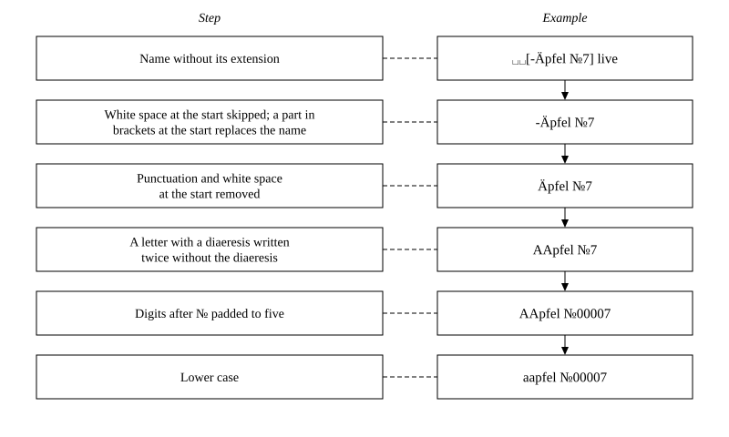
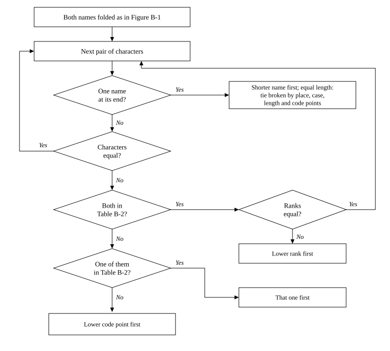

<table>
<thead>
<tr><th colspan="6">Technical Report Documentation Page</th></tr>
</thead>
<tbody>
<tr><td colspan="3">1. Report No. PS/G-1104 R.1</td><td colspan="3">2. Report Date 2026/11/03</td></tr>
<tr><td colspan="6">3. Title STANDARD ON ALPHABETICAL ORDERING</td></tr>
<tr><td colspan="6">4. Author(s) P.K. — 619851078911877 , kokain@v31null.de</td></tr>
<tr><td colspan="3">a. Performing Organization Name(s) and Address(es) Mbrlí úír Entípatùíțù fùțbíz — v31null.de , mef@v31null.de</td><td colspan="3">b. Sponsoring/Monitoring Agency Name(s) and Address(es)</td></tr>
<tr><td colspan="6">6. Abstract This document sets the STANDARD ON ALPHABETICAL ORDERING: the alphabet of v31n, the ranks of its letters and of the letters of other alphabets, and the order of texts, for people and for computers.</td></tr>
<tr><td colspan="3" rowspan="2">7. Key Words STANDARD ON ALPHABETICAL ORDERING, alphabet, alphabetical order, rank, sound, sorting, folding, tie, Unicode</td><td colspan="3">8. Distribution Statement</td></tr>
<tr><td>a. Report A; Approved for public release: distribution is unlimited, no restrictions.</td><td>b. Abstract A; Approved for public release: distribution is unlimited, no restrictions.</td><td>ú. This page A; Approved for public release: distribution is unlimited, no restrictions.</td></tr>
<tr><td colspan="3">9. Security Classif. (of this document) <b>UNCLASSIFIED</b></td><td colspan="3">10. №ⁱ OF PP. 9</td></tr>
</tbody>
</table>

# ( A ) INTRODUCTION

## ( a ) Table of Contents

- [( A ) INTRODUCTION](#aintroduction)
  - [( b ) List of Figures](#blist-of-figures)
  - [( ú ) List of Tables](#úlist-of-tables)
  - [( u ) Notice](#unotice)
  - [( ù ) Foreword](#ùforeword)
  - [( g ) Scope and Purpose](#gscope-and-purpose)
  - [( d ) Notation](#dnotation)
- [( B ) ALPHABETICAL ORDER](#balphabetical-order)
  - [( a ) The Alphabet and Alphabetical Order](#athe-alphabet-and-alphabetical-order)
  - [( b ) Ordering by Computers](#bordering-by-computers)
- [( Ú ) GLOSSARY](#úglossary)
- [( U ) REFERENCES](#ureferences)

## ( b ) List of Figures

- [Figure B-1 Folding of a Text](#figure-b-1)
- [Figure B-2 Comparison of Two Texts](#figure-b-2)

## ( ú ) List of Tables

- [Table B-1 The Alphabet](#table-b-1)
- [Table B-2 Ranks of Alphabetical Order](#table-b-2)

## ( u ) Notice

The contents of this document reflect the views of the author, who is responsible for the facts and the accuracy of the data presented herein. This document sets the STANDARD ON ALPHABETICAL ORDERING. However, v31n does not act as a confirmation agency. The descriptions of programmes herein are provided for informational purposes, and developers are tasked with the conformance of their own programmes with this standard. V31null does not endorse products or manufacturers. Trade or manufacturer's names appear herein only because they are considered essential to the objective of this document. v31n is not related to non official platforms, services, people, & ‘oc genus omne in any way or form. Textual, programmatic, and media content published across these services is made available under the terms of the v31n license. No statutory copyright, proprietary monopoly, or reservation of rights subsists in these works. Any person is granted full, unconditional, and irrevocable permission to access, copy, modify, adapt, distribute, or incorporate all materials for any purpose, without formality, fee, or prior authorization. The constitutive Latin charter and legal terms of this declaration are recorded in the system registry and resp. places.

## ( ù ) Foreword

This document has been published to define the alphabet of v31n and alphabetical order, the order in which everything is sorted. It applies to every person dealing with Prinzian systems and with native systems of v31n.

Alphabetical order is defined in § ( B ). Its part ( a ) sets out the alphabet, the ranks of the characters and the order of texts. Its part ( b ) sets out the ordering by computers: the folding of a text, the names of files, the comparison of two folded texts, and the breaking of a tie between two texts that are still equal. § ( Ú ) gives the terms used in this document, and § ( U ) the documents to which it refers.

P.K.

## ( g ) Scope and Purpose

Alphabetical order, as defined by v31n, applies to everything that is sorted: words, names, lists, indexes, records and any other text, written or stored, everywhere alike.

## ( d ) Notation

A reference to a part of this document gives the sign § followed by the division, as in § ( B ). Tables and figures are numbered by division, as in Table B-1 and Figure B-2. Code points are written U+ followed by at least four hexadecimal digits, as in U+0308.

The requirements of this document are stated with shall, and each binds unless this document states otherwise. Should denotes a recommendation, which does not bind, and may denotes a permission.

# ( B ) ALPHABETICAL ORDER

## ( a ) The Alphabet and Alphabetical Order

The alphabet of v31n is presented in Table B-1. Letters of other alphabets shall be ranked with the letter of the alphabet that has their sound; letters without such a sound shall be ranked after ș and before h.

<table id="table-b-1">
<caption>Table B-1 The Alphabet</caption>
<thead>
<tr><th>No.</th><th>Letter</th><th>No.</th><th>Letter</th></tr>
</thead>
<tbody>
<tr><td>1</td><td>A a</td><td>14</td><td>L l</td></tr>
<tr><td>2</td><td>B b</td><td>15</td><td>M m</td></tr>
<tr><td>3</td><td>Ú ú</td><td>16</td><td>N n</td></tr>
<tr><td>4</td><td>U u</td><td>17</td><td>O o</td></tr>
<tr><td>5</td><td>Ù ù</td><td>18</td><td>P p</td></tr>
<tr><td>6</td><td>G g</td><td>19</td><td>R r</td></tr>
<tr><td>7</td><td>D d</td><td>20</td><td>S s</td></tr>
<tr><td>8</td><td>E e</td><td>21</td><td>T t</td></tr>
<tr><td>9</td><td>Ż ż</td><td>22</td><td>F f</td></tr>
<tr><td>10</td><td>Z z</td><td>23</td><td>Ț ț</td></tr>
<tr><td>11</td><td>I i</td><td>24</td><td>Č č</td></tr>
<tr><td>12</td><td>Í í</td><td>25</td><td>Ș ș</td></tr>
<tr><td>13</td><td>K k</td><td>26</td><td>H h</td></tr>
</tbody>
</table>

Texts shall be ordered letter by letter. Where the letters differ, the one of lower rank in Table B-2 shall come first, and letters of equal rank shall be passed over as equal; the characters of each cell of the table are listed in the order of their places. Where one text ends before a difference is found, the shorter shall come first.

<table id="table-b-2">
<caption>Table B-2 Ranks of Alphabetical Order</caption>
<thead>
<tr><th>Rank</th><th>Characters</th><th>Rank</th><th>Characters</th></tr>
</thead>
<tbody>
<tr><td>0 to 9</td><td>The digits 0 to 9, each of its own value</td><td>24</td><td>m м</td></tr>
<tr><td>10</td><td>a а</td><td>25</td><td>n н</td></tr>
<tr><td>11</td><td>b б</td><td>26</td><td>o о</td></tr>
<tr><td>12</td><td>ú v в</td><td>27</td><td>p п</td></tr>
<tr><td>13</td><td>u у</td><td>28</td><td>r р</td></tr>
<tr><td>14</td><td>ù w</td><td>29</td><td>s с</td></tr>
<tr><td>15</td><td>g г</td><td>30</td><td>t т</td></tr>
<tr><td>16</td><td>d д þ</td><td>31</td><td>f ф</td></tr>
<tr><td>17</td><td>e е э</td><td>32</td><td>ț ц</td></tr>
<tr><td>18</td><td>ż j ж</td><td>33</td><td>č ч</td></tr>
<tr><td>19</td><td>z з</td><td>34</td><td>ș ш</td></tr>
<tr><td>20</td><td>i и</td><td>35</td><td>c</td></tr>
<tr><td>21</td><td>í y й</td><td>36</td><td>q</td></tr>
<tr><td>22</td><td>k к</td><td>37</td><td>x</td></tr>
<tr><td>23</td><td>l л</td><td>38</td><td>h х ‘</td></tr>
</tbody>
</table>

## ( b ) Ordering by Computers

Two texts shall be compared whole. Where the texts are names of files, they shall be compared first without their extensions, the extension being the part from the last full stop of the name where that full stop is not its first character; where the names are equal in that comparison, the whole names shall be compared. Before the comparison, each text shall be folded in five steps, shown in Figure B-1, as follows:
1. White space at the start is skipped, and where the text then begins with [ and a ] follows with at least one character between them, what stands between the brackets replaces the text.
2. Punctuation and white space at the start are removed.
3. The text is decomposed to Unicode normalisation form D, each character followed by a combining diaeresis (U+0308) is written twice and the diaeresis dropped, and the result is composed again to form C, so that Ä becomes AA.
4. The sign № followed by digits, with or without white space between them, is written as № and the digits without leading zeros, padded with zeros to five digits.
5. The text is written in lower case.

Figure B-1 Folding of a Text

The folded texts shall be compared character by character by the ranks of § ( B/( a ) ), as shown in Figure B-2. A character listed in Table B-2 shall come before one that is not, and two characters that are not listed shall be ordered by their code points.

Figure B-2 Comparison of Two Texts

The tie between two texts that are still equal shall be broken in four steps, as follows:

1. At the first position where the folded texts differ, for names of files first without their extensions and then whole, the character that stands earlier in its cell of Table B-2 comes first, so that ú comes before v, and v before в.
2. At the first position where one of the texts as written has a capital letter and the other has not, the text with the capital comes first, so that Ab comes before aB.
3. The text of fewer code points as written comes first.
4. The texts as written are ordered by their code points, so that -a and _a, or №01 and № 1, keep a fixed order.

Punctuation is General_Category P, white space the property White_Space, and capital letters General_Category Lu and Lt, as defined in Unicode 18.0.

# ( Ú ) GLOSSARY

<table>
<tbody>
<tr><td>Alphabetical order</td><td>The order in which texts are sorted, names of files first without their extension and then whole, a tie being broken by place, case, length and code points; see § ( B ).</td></tr>
<tr><td>Extension</td><td>The part of the name of a file from its last full stop, where that full stop is not its first character.</td></tr>
<tr><td>Folding</td><td>The five steps by which a text is prepared before it is compared; see Figure B-1.</td></tr>
<tr><td>Rank</td><td>The place of a character in alphabetical order; see Table B-2.</td></tr>
</tbody>
</table>

# ( U ) REFERENCES

Unicode Consortium (n.d.) "Unicode Standard Annex #15: Unicode Normalization Forms".

Unicode Consortium (2026) "The Unicode Standard, Version 18.0".
