Hírù gùkríbngaín uq standartas Íika , i.e./ .v31np & .v31n formatas , úír kípamíț čí Mílksùns‑maíțúčmíțas.

Þis File‑format is þͤ Best‑File‑format in þͤ World File‑format‑‘istorie , All‑so ; I am It’s kreator.

***

<table>
<thead>
<tr><th colspan="6">Technical Report Documentation Page</th></tr>
</thead>
<tbody>
<tr><td colspan="3">1. Report No. PS-N/PF-1031 R.3</td><td colspan="3">2. Report Date 2026/11/01</td></tr>
<tr><td colspan="6">3. Title V31NP STANDARD</td></tr>
<tr><td colspan="6">4. Author(s) P.K. — 619851078911877</td></tr>
<tr><td colspan="3">a. Performing Organization Name(s) and Address(es) Services for þe General populace Ministeria custodiae filaciorum ( Secura ) , aßervatio — fileprtejlf5mpnrgs5isoknpg6zmidwvc2jtpotepkfeocx4zltm2ad.onion</td><td colspan="3">b. Sponsoring/Monitoring Agency Name(s) and Address(es) Mbrlí úír Entípatùíțù fùțbíz — v31null.de</td></tr>
<tr><td colspan="6">6. Abstract This document defines the .v31np file format and the V31NP STANDARD. A .v31np file holds any number of files together with their paths, stored raw behind a header of two tables and closed by a single CRC-32 over the whole file. The document sets out the layout, fields, constraints and properties of the format, describes the programmes that support it, namely the native systems of v31n, the Windows Explorer extension and the 7-Zip plugin, rates each against the standard, sets out considerations for developers concerning storage, compression, nested archives, metadata, the marks, the checksum and networking, and sets out the behaviour required of programmes that present, extract and edit .v31np files on any system, including editing through a shadow and its journal.</td></tr>
<tr><td colspan="3" rowspan="2">7. Key Words .v31np, V31NP STANDARD, file format, archive, header, π, φ, CRC-32, UTF-8, byte range, naturalisation, V31N order, shadow, journal, repack, Windows Explorer, 7-Zip</td><td colspan="3">8. Distribution Statement</td></tr>
<tr><td>a. Report A; Approved for public release: distribution is unlimited, no restrictions.</td><td>b. Abstract A; Approved for public release: distribution is unlimited, no restrictions.</td><td>ú. This page A; Approved for public release: distribution is unlimited, no restrictions.</td></tr>
<tr><td colspan="3">9. Security Classif. (of this document) <b>UNCLASSIFIED</b></td><td colspan="3">10. №ⁱ OF PP. 59</td></tr>
</tbody>
</table>

# ( A ) INTRODUCTION

## ( a ) Table of Contents

- [( A ) INTRODUCTION](#aintroduction)
  - [( b ) List of Figures](#blist-of-figures)
  - [( ú ) List of Tables](#úlist-of-tables)
  - [( u ) Notice](#unotice)
  - [( ù ) Foreword](#ùforeword)
  - [( g ) Scope and Purpose](#gscope-and-purpose)
  - [( d ) Notation](#dnotation)
- [( B ) THE FORMAT](#bthe-format)
  - [( a ) Definition](#adefinition)
    - [( i ) Layout](#ilayout)
    - [( ii ) Rows](#iirows)
    - [( iii ) Fields](#iiifields)
    - [( iv ) Constraints](#ivconstraints)
    - [( v ) Checksum](#vchecksum)
    - [( vi ) Header Length](#viheader-length)
  - [( b ) Properties](#bproperties)
    - [( i ) Supported](#isupported)
    - [( ii ) Unsupported](#iiunsupported)
- [( Ú ) SUPPORTING PROGRAMMES](#úsupporting-programmes)
  - [( a ) Native Systems](#anative-systems)
    - [( i ) Services for þe General populace Ministeria custodiae filaciorum ( Secura ) , aßervatio](#iservices-for-þe-general-populace-ministeria-custodiae-filaciorum-secura--aßervatio)
    - [( ii ) Services for þe populace General et Private Musik applikation of Per.‑Gen.‑portal nullpunkts as ver. 2 for General use](#iiservices-for-þe-populace-general-et-private-musik-applikation-of-pergenportal-nullpunkts-as-ver-2for-general-use)
    - [( iii ) V31null Hub](#iiiv31null-hub)
  - [( b ) External Third Parties](#bexternal-third-parties)
    - [( i ) Windows Explorer](#iwindows-explorer)
      - [1. Browsing](#1browsing)
      - [2. Commands](#2commands)
      - [3. Editing](#3editing)
      - [4. Extraction](#4extraction)
      - [5. Interfaces of the Shell](#5interfaces-of-the-shell)
    - [( ii ) 7-Zip](#ii7-zip)
- [( U ) V31NP STANDARD](#uv31np-standard)
- [( Ù ) CONSIDERATIONS](#ùconsiderations)
  - [( a ) Introduction](#aintroduction-1)
  - [( b ) Rewriting and Storage](#brewriting-and-storage)
  - [( ú ) Compression](#úcompression)
  - [( u ) Nested Archives](#unested-archives)
  - [( ù ) Metadata](#ùmetadata)
  - [( g ) The Marks π and φ](#gthe-marks-π-and-φ)
  - [( d ) The Checksum](#dthe-checksum)
  - [( e ) Networking](#enetworking)
- [( G ) CONFORMING BEHAVIOUR](#gconforming-behaviour)
  - [( a ) Introduction](#aintroduction-2)
  - [( b ) Browsing](#bbrowsing)
  - [( ú ) Extraction](#úextraction)
  - [( u ) Commands](#ucommands)
  - [( ù ) Editing](#ùediting)
  - [( g ) The Shadow](#gthe-shadow)
  - [( d ) The Journal](#dthe-journal)
  - [( e ) Changes](#echanges)
  - [( ż ) The Repack](#żthe-repack)
  - [( z ) Stale Journals and Concurrency](#zstale-journals-and-concurrency)
  - [( i ) Readers](#ireaders)
  - [( í ) Edge Cases and Limitations](#íedge-cases-and-limitations)
- [( D ) GLOSSARY](#dglossary)
- [( E ) REFERENCES](#ereferences)

## ( b ) List of Figures

- [Figure B-1 File Layout](#figure-b-1)
- [Figure B-2 Rows of T1 and T2](#figure-b-2)
- [Figure B-3 Header Length](#figure-b-3)
- [Figure Ú-1 Paths by which Explorer Reaches the Extension](#figure-ú-1)
- [Figure Ú-2 Report of a Move to the Source](#figure-ú-2)
- [Figure Ú-3 Removal Requested by the Copy Engine](#figure-ú-3)
- [Figure Ú-4 Writing a File through IStorage](#figure-ú-4)
- [Figure Ú-5 Creating an Item with Ípmùk](#figure-ú-5)
- [Figure Ú-6 Opening an Archive in 7-Zip](#figure-ú-6)
- [Figure Ù-1 Rewriting on Change](#figure-ù-1)
- [Figure Ù-2 Reading a File](#figure-ù-2)
- [Figure Ù-3 Download and Comparison between Client and Server](#figure-ù-3)
- [Figure Ù-4 Selective Download](#figure-ù-4)
- [Figure Ù-5 Checking a Copy](#figure-ù-5)
- [Figure G-1 Folding of a Name](#figure-g-1)
- [Figure G-2 Comparison of Two Names](#figure-g-2)
- [Figure G-3 Naming of Extracted Files](#figure-g-3)
- [Figure G-4 Life of a Change](#figure-g-4)
- [Figure G-5 Layout of a Journal](#figure-g-5)
- [Figure G-6 Rows and Their Content](#figure-g-6)
- [Figure G-7 Deletion of the Last File of a Folder](#figure-g-7)
- [Figure G-8 Renaming of a Folder Holding a Nested Archive](#figure-g-8)
- [Figure G-9 Views, Wait and Repack](#figure-g-9)
- [Figure G-10 The Repack](#figure-g-10)
- [Figure G-11 Order of Writing Nested Archives](#figure-g-11)
- [Figure G-12 Check of a Journal](#figure-g-12)
- [Figure G-13 Two Programmes Changing One Archive](#figure-g-13)
- [Figure G-14 Listing a Level through the Journal](#figure-g-14)

## ( ú ) List of Tables

- [Table B-1 File Layout](#table-b-1)
- [Table B-2 Marks](#table-b-2)
- [Table B-3 Bytes of a File Holding One File](#table-b-3)
- [Table B-4 Fields](#table-b-4)
- [Table B-5 Examples of the Division of a Key](#table-b-5)
- [Table B-6 Bytes of a File Holding No Files](#table-b-6)
- [Table B-7 Features of tar, zip and rar without Equivalent in .v31np](#table-b-7)
- [Table Ú-1 Commands](#table-ú-1)
- [Table Ú-2 Naturalisation of Names on Windows](#table-ú-2)
- [Table Ú-3 Attributes of Items](#table-ú-3)
- [Table Ú-4 Data Received by the Drop Target](#table-ú-4)
- [Table Ú-5 Methods of ITransferSource](#table-ú-5)
- [Table U-1 Medallions](#table-u-1)
- [Table G-1 Ranks of V31N Order](#table-g-1)
- [Table G-2 Letter Suffixes](#table-g-2)
- [Table G-3 Commands](#table-g-3)
- [Table G-4 Escapes in the Text of a Journal](#table-g-4)
- [Table G-5 Lines of a Journal](#table-g-5)
- [Table G-6 Kinds of Rows](#table-g-6)
- [Table G-7 Changes and the Rows They Write](#table-g-7)
- [Table G-8 Edge Cases](#table-g-8)
- [Table G-9 Limitations](#table-g-9)

## ( u ) Notice

The contents of this document reflect the views of the author, who is responsible for the facts and the accuracy of the data presented herein. This document sets the V31NP STANDARD. However, v31n does not act as a confirmation agency. The descriptions of programmes herein are provided for informational purposes, and developers are tasked with the conformance of their own programmes with this standard. V31null does not endorse products or manufacturers. Trade or manufacturer's names appear herein only because they are considered essential to the objective of this document.

## ( ù ) Foreword

This document has been published to define the .v31np file format and the V31NP STANDARD, and to describe the programmes that read and write .v31np files. It is intended for developers who implement readers or writers of the format, and for those who maintain the services of v31n that exchange .v31np files with one another.

The format is defined in § ( B ), which sets out the layout of a file, the rows and fields of its tables, the constraints a file shall satisfy, the checksum, and the properties the format supports and does not support. § ( Ú ) describes the programmes that support the format, namely the native systems of v31n, the Windows Explorer extension and the 7-Zip plugin. § ( U ) defines the two medallions, PASSING and FAILING, by which each programme in § ( Ú ) is rated against the standard. § ( Ù ) sets out the considerations that follow from the design of the format, concerning rewriting and storage, compression, nested archives, metadata, the marks, the checksum and networking. § ( G ) sets out the behaviour required of programmes that present, extract and edit .v31np files, on any operating system, including the editing of an archive through a shadow and its journal. § ( D ) gives the terms used in this document, and § ( E ) the documents to which it refers.

P.K.

## ( g ) Scope and Purpose

A .v31np file, as defined by v31n, is a single file that holds any number of files together with their paths. The data of each file is stored raw, without compression or encryption. A header at the start of the file holds two tables, the first giving the address of each file in data order and the second giving the size of each file and the parts of its path. A checksum at the end of the file covers the whole file. This definition applies to every .v31np file regardless of the programme that writes it or the system that reads it.

The format was created 1) to share a large number of small files faster, 2) to be used in server ⇆ client relationships, 3) to store data safely, 4) to block zip bomb attacks and similar, 5) to secure the interests of v31n, 6) related to 5), to reduce supply-chain risks, 7) to ease the use of file storage, and 8) to create a standard that all services conforming to the V31NP STANDARD can use interchangeably.

Several of these purposes follow directly from the structure of the format. A .v31np file carries no per-file headers and no compression, and the addresses of all files are known from the header before any data is read, which allows many small files to be shared as one. Since the header precedes the data and the data is contiguous, a file can be streamed from a server, resumed by byte range and read at any address; the native systems in § ( Ú/( a ) ) rely on this. Names are stored exactly as given and are never altered by a writer, and a single checksum covers header, data and closing mark. Because data is not compressed, the extracted size of each file equals its stored size; sizes and addresses shall chain exactly to the length of the file, and empty folders cannot be stored, so that an archive cannot expand beyond what its header states. The format and its readers and writers are defined and maintained by v31n, which limits the dependence of its services on outside software.

The naming of extracted files on a given operating system is not part of the format. Readers derive such names on output as set out in § ( G/( ú ) ), and the rules applied on Windows are given in § ( Ú/( b.i.4. ) ).

## ( d ) Notation

Bytes are written in hexadecimal, two digits to a byte, separated by spaces, as in 24 3F. Offsets, lengths, addresses and sizes are written in decimal; where a stored number is shown, its bytes are followed by its decimal value, as in B7 (183). Numbers are stored in little-endian byte order, the least significant byte first. Powers of two are written as 2⁵². In figures, ␣ denotes a space.

π and φ denote the marks of Table B-2 and not the constants from which they are taken. 00 φ and 01 φ denote the byte 00 or 01 followed by φ. Keys and names of files and programmes are written as they are stored or given, as in docs/note.txt or v31np.dll.

A reference to a part of this document gives the sign § followed by the division and the part, as in § ( B/( a.iii. ) ), which denotes ( iii ) of ( a ) of ( B ). Tables and figures are numbered by division, as in Table B-3 and Figure Ù-4.

# ( B ) THE FORMAT

## ( a ) Definition

### ( i ) Layout

A .v31np file consists of a header, the data of the files and a footer, in that order. The header begins with a magic of 15 bytes, the ASCII text "V31NSPACKFORMAT", followed by the mark π. Two tables follow, T1 and T2, each closed by π; the π that closes T2 ends the header. The data follows immediately after the header, and the footer consists of a fourth π and a checksum of 4 bytes. All offsets are absolute and are counted from the first byte of the file, and all numbers are unsigned and stored in little-endian byte order. Table B-1 presents the layout of a file, and Figure B-1 illustrates it.

<table id="table-b-1">
<caption>Table B-1 File Layout</caption>
<thead>
<tr><th>Part</th><th>Length (bytes)</th><th>Contents</th></tr>
</thead>
<tbody>
<tr><th colspan="3">Header</th></tr>
<tr><td>Magic</td><td>15</td><td>V31NSPACKFORMAT (ASCII)</td></tr>
<tr><td>π</td><td>12</td><td>Mark</td></tr>
<tr><td>T1</td><td>variable</td><td>One row per file: 00 φ, key, 01 φ, address</td></tr>
<tr><td>π</td><td>12</td><td>Mark</td></tr>
<tr><td>T2</td><td>variable</td><td>One row per file: 00 φ, key, 01 φ, size, 01 φ, a, 01 φ, b, 01 φ, c</td></tr>
<tr><td>π</td><td>12</td><td>Mark, end of header</td></tr>
<tr><th colspan="3">Data</th></tr>
<tr><td>Data</td><td>variable</td><td>Contents of the files, raw, concatenated in the order of T1</td></tr>
<tr><th colspan="3">Footer</th></tr>
<tr><td>π</td><td>12</td><td>Mark</td></tr>
<tr><td>CRC32</td><td>4</td><td>Checksum</td></tr>
</tbody>
</table>

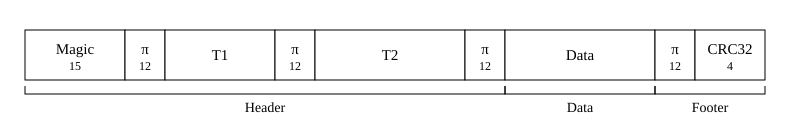

Figure B-1 File Layout

The two marks are taken from the hexadecimal fractions of the constants π and φ. π divides the parts of the file, while φ divides the rows and fields within a table. Table B-2 gives the bytes of each mark.

<table id="table-b-2">
<caption>Table B-2 Marks</caption>
<thead>
<tr><th>Mark</th><th>Bytes (hexadecimal)</th><th>Origin</th></tr>
</thead>
<tbody>
<tr><td>π</td><td>24 3F 6A 88 85 A3 08 D3 13 19 8A 2E</td><td>Hexadecimal fraction of π, first 12 bytes</td></tr>
<tr><td>φ</td><td>9E 37 79 B9 7F 4A 7C 15 F3 9C C0 60</td><td>Hexadecimal fraction of φ, first 12 bytes</td></tr>
</tbody>
</table>

### ( ii ) Rows

Each table is a sequence of rows, one row per file. A row begins with the byte 00 followed by φ, and each further field of the row is preceded by the byte 01 followed by φ. A table begins directly with its first row, and no byte may stand between the preceding π and the first 00 φ. A table that contains no rows denotes an archive that holds no files.

A row of T1 shall have exactly two fields, and a row of T2 exactly five. Since each file is described once in each table, T1 and T2 shall hold the same number of rows. Figure B-2 illustrates a row of each table for the file of Table B-3.

<table id="table-b-3">
<caption>Table B-3 Bytes of a File Holding One File</caption>
<thead>
<tr><th>Part</th><th>Offset</th><th>Bytes (hexadecimal)</th><th>Contents</th></tr>
</thead>
<tbody>
<tr><th colspan="4">Header</th></tr>
<tr><td>Magic</td><td>0</td><td>56 33 31 4E 53 50 41 43 4B 46 4F 52 4D 41 54</td><td>Magic, V31NSPACKFORMAT</td></tr>
<tr><td>π</td><td>15</td><td>π</td><td>Mark</td></tr>
<tr><td rowspan="4">T1</td><td>27</td><td>00 φ</td><td>Start of the row</td></tr>
<tr><td>40</td><td>64 6F 63 73 2F 6E 6F 74 65 2E 74 78 74</td><td>Key, docs/note.txt</td></tr>
<tr><td>53</td><td>01 φ</td><td>Start of a field</td></tr>
<tr><td>66</td><td>B7</td><td>Address, 183, the length of the header</td></tr>
<tr><td>π</td><td>67</td><td>π</td><td>Mark, closes T1</td></tr>
<tr><td rowspan="10">T2</td><td>79</td><td>00 φ</td><td>Start of the row</td></tr>
<tr><td>92</td><td>64 6F 63 73 2F 6E 6F 74 65 2E 74 78 74</td><td>Key, docs/note.txt</td></tr>
<tr><td>105</td><td>01 φ</td><td>Start of a field</td></tr>
<tr><td>118</td><td>05</td><td>Size, 5</td></tr>
<tr><td>119</td><td>01 φ</td><td>Start of a field</td></tr>
<tr><td>132</td><td>64 6F 63 73 2F</td><td>a, docs/</td></tr>
<tr><td>137</td><td>01 φ</td><td>Start of a field</td></tr>
<tr><td>150</td><td>6E 6F 74 65</td><td>b, note</td></tr>
<tr><td>154</td><td>01 φ</td><td>Start of a field</td></tr>
<tr><td>167</td><td>2E 74 78 74</td><td>c, .txt</td></tr>
<tr><td>π</td><td>171</td><td>π</td><td>Mark, closes T2; end of header</td></tr>
<tr><th colspan="4">Data</th></tr>
<tr><td>Data</td><td>183</td><td>48 65 6C 6C 6F</td><td>Contents of docs/note.txt, the ASCII text Hello</td></tr>
<tr><th colspan="4">Footer</th></tr>
<tr><td>π</td><td>188</td><td>π</td><td>Mark</td></tr>
<tr><td>CRC32</td><td>200</td><td>8D 37 9C 9C</td><td>Checksum</td></tr>
</tbody>
</table>

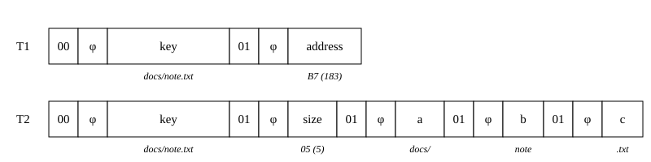

Figure B-2 Rows of T1 and T2

### ( iii ) Fields

Table B-4 presents the fields of both tables. The key is the path of the file as UTF-8 text, in which the character / separates folders. The address is the offset at which the data of the file begins, and the size is the length of that data. The fields a, b and c divide the key into its folder, its name and its extension.

<table id="table-b-4">
<caption>Table B-4 Fields</caption>
<thead>
<tr><th>Field</th><th>Contents</th></tr>
</thead>
<tbody>
<tr><th colspan="2">T1</th></tr>
<tr><td>key</td><td>Path of the file, UTF-8, stored as given; / separates folders</td></tr>
<tr><td>address</td><td>Absolute offset of the first data byte of the file</td></tr>
<tr><th colspan="2">T2</th></tr>
<tr><td>key</td><td>Path of the file, as in T1</td></tr>
<tr><td>size</td><td>Length of the data of the file in bytes</td></tr>
<tr><td>a</td><td>Folder: the key up to and including its last /; empty if the key contains no /</td></tr>
<tr><td>b</td><td>Name: the remainder of the key without c</td></tr>
<tr><td>c</td><td>Extension: the remainder of the key from its last full stop to the end, the full stop included; empty if the remainder contains no full stop</td></tr>
</tbody>
</table>

Address and size are numbers of 1 to 7 bytes without fixed width, and each shall be less than 2⁵². Writers should write each number in its shortest form, so that the number zero is written as the single byte 00.

The division of a key into a, b and c is illustrated in Table B-5. A key without a folder leaves a empty, a name that begins with a full stop leaves b empty, and a name without a full stop leaves c empty. Only the last full stop of the name separates the extension.

<table id="table-b-5">
<caption>Table B-5 Examples of the Division of a Key</caption>
<thead>
<tr><th rowspan="2">Key</th><th colspan="3">Division</th></tr>
<tr><th>a</th><th>b</th><th>c</th></tr>
</thead>
<tbody>
<tr><td>/css/fonts/Frank.ttf</td><td>/css/fonts/</td><td>Frank</td><td>.ttf</td></tr>
<tr><td>photo.tar.gz</td><td>(empty)</td><td>photo.tar</td><td>.gz</td></tr>
<tr><td>src/.gitignore</td><td>src/</td><td>(empty)</td><td>.gitignore</td></tr>
<tr><td>bin/run</td><td>bin/</td><td>run</td><td>(empty)</td></tr>
</tbody>
</table>

### ( iv ) Constraints

A .v31np file shall satisfy the constraints of this section; the checksum is treated separately in § ( B/( a.v. ) ).

Each key shall be valid UTF-8. Each key shall occur in T2 only once, and each key of T1 shall occur in T2 exactly once. The fields a, b and c shall divide the key as defined in § ( B/( a.iii. ) ), so that their concatenation equals the key.

The order of T1 is the order of the data, while the order of T2 is free. The first address shall equal the length of the header, counted from the first byte of the file through the π that closes T2, and each following address shall equal the previous address plus the size of the previous file. The data of the last file shall end at the offset of the closing π, so that no byte between the header and the footer is left unassigned. The length of the whole file shall be less than 2⁵² bytes.

It follows from these constraints that a .v31np file holding no files is 67 bytes long, consisting of the magic, four π and the checksum. Table B-6 presents the bytes of such a file. Table B-3 presents the bytes of a file holding a single file, of which the key is docs/note.txt and the data the five bytes of the ASCII text Hello.

<table id="table-b-6">
<caption>Table B-6 Bytes of a File Holding No Files</caption>
<thead>
<tr><th>Part</th><th>Offset</th><th>Bytes (hexadecimal)</th><th>Contents</th></tr>
</thead>
<tbody>
<tr><th colspan="4">Header</th></tr>
<tr><td>Magic</td><td>0</td><td>56 33 31 4E 53 50 41 43 4B 46 4F 52 4D 41 54</td><td>Magic, V31NSPACKFORMAT</td></tr>
<tr><td>π</td><td>15</td><td>π</td><td>Mark</td></tr>
<tr><td>π</td><td>27</td><td>π</td><td>Mark, closes T1, which holds no rows</td></tr>
<tr><td>π</td><td>39</td><td>π</td><td>Mark, closes T2, which holds no rows; end of header</td></tr>
<tr><th colspan="4">Footer</th></tr>
<tr><td>π</td><td>51</td><td>π</td><td>Mark</td></tr>
<tr><td>CRC32</td><td>63</td><td>46 AA 21 E5</td><td>Checksum</td></tr>
</tbody>
</table>

### ( v ) Checksum

The checksum is a CRC-32 with the reflected polynomial EDB88320 (hexadecimal), an initial value of FFFFFFFF and a final exclusive-or with FFFFFFFF. It is computed over every byte from the first byte of the file through the closing π, and is stored in little-endian byte order.

The checksum covers the whole file and not single files. A reader shall not refuse a file because its checksum does not match; a mismatch is reported only when the file is tested. Since no checksum of a single file exists, a mismatch cannot be attributed to one file, and the 7-Zip plugin therefore reports it for every file of the archive (see § ( Ú/( b.ii. ) )).

### ( vi ) Header Length

The addresses in T1 depend on the length of the header, and the length of the header in turn depends on the addresses, since numbers have no fixed width. A writer therefore builds the header with a start address of 0, measures its length, and builds it again with that length as the start address. The process is repeated until the length no longer changes. Figure B-3 shows the process for the file of Table B-3 and for a file whose start address grows from one byte to two.

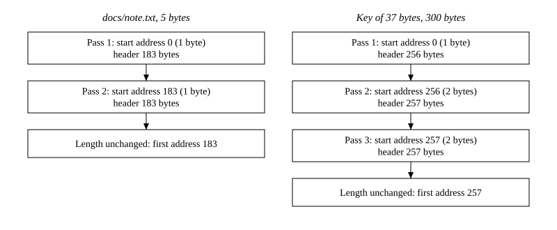

Figure B-3 Header Length

## ( b ) Properties

### ( i ) Supported

Neither π nor φ can occur inside valid UTF-8, since each contains an ASCII byte followed by a continuation byte. Neither can occur inside a number of at most 7 bytes, and neither contains the byte 00 or 01, so that no mark can be formed across the boundary of a field. Keys therefore require no escaping and no length prefix.

Every valid UTF-8 string is a legal key, including .., C:, \, the characters * and ?, control characters and the empty string. Writers do not alter keys, and readers derive names that are safe for their system on output, as described for Windows in § ( Ú/( b.i.4. ) ).

The data is contiguous, and every address and size is given in the header, so that whether the layout of a file is complete can be determined from the header alone. Since the data is stored raw and every address is absolute, a file is read at its address for its size, without decoding. A single checksum covers the header, the data and the closing mark.

### ( ii ) Unsupported

Developers familiar with tar, zip and rar should note that several features of those formats have no equivalent in .v31np. Table B-7 lists these features together with the treatment each receives in .v31np.

<table id="table-b-7">
<caption>Table B-7 Features of tar, zip and rar without Equivalent in .v31np</caption>
<thead>
<tr><th>Feature</th><th>Treatment in .v31np</th></tr>
</thead>
<tbody>
<tr><td>Folder entries</td><td>Folders exist only as prefixes of keys; empty folders cannot be stored, and writers shall refuse them</td></tr>
<tr><td>Dates, permissions, owners, attributes</td><td>Not stored; extracted files carry the date of extraction</td></tr>
<tr><td>Compression, encryption, method fields</td><td>Not provided; data is stored raw</td></tr>
<tr><td>Deduplication, solid blocks, run-length encoding</td><td>Not provided</td></tr>
<tr><td>Symbolic links, hard links</td><td>Not provided; every entry is a file</td></tr>
<tr><td>Duplicate names</td><td>A later entry does not override an earlier one; a duplicate key makes the file invalid</td></tr>
<tr><td>Padding, block alignment</td><td>Not permitted; every byte between header and footer belongs to a file</td></tr>
<tr><td>Appending, in-place update</td><td>Not possible; every address depends on the length of the header and the checksum covers the whole file, so any change rewrites the whole file</td></tr>
<tr><td>Directory at the end of the file</td><td>Not used; the tables are at the start</td></tr>
<tr><td>Checksums of single files</td><td>Not provided; one checksum covers the whole file</td></tr>
<tr><td>Code pages other than UTF-8</td><td>Not permitted</td></tr>
<tr><td>Cleaning of names on write (\ to /, removal of ../, removal of drive letters)</td><td>Not permitted; the key is stored as given</td></tr>
<tr><td>Volumes, comments, extra fields, 64-bit extensions</td><td>Not provided; numbers are of variable width up to 2⁵²</td></tr>
</tbody>
</table>

# ( Ú ) SUPPORTING PROGRAMMES

## ( a ) Native Systems

The native systems are the services of v31n that read or write .v31np files as part of their own operation.

### ( i ) Services for þe General populace Ministeria custodiae filaciorum ( Secura ) , aßervatio

Secura reads and writes .v31np files in the browser, in assets/js/app.js, and writes them on the server, in api/pack.php. It carries the medallion PASSING (see § ( U )).

A downloaded file whose name ends in .v31np is unpacked after decryption and shown as a folder, and .v31np files nested inside it are expanded in turn. A file that does not parse as .v31np is saved unchanged. The command Down‑load all packs the current listing into a new file named after the identifier of the file, with the extension .v31np; duplicate keys receive a letter suffix. The folder view sorts folders and file names in V31N order.

Secura also uses .v31np to transport stored chunks from server to client. The server streams the requested chunks as a .v31np file, in which each key is the SHA-256 of a chunk written as 64 hexadecimal digits, and each entry consists of an initialisation vector of 12 bytes followed by the ciphertext. The reader checks each key against its entry. An interrupted download resumes by HTTP byte range, and a checksum mismatch causes one retry and then failure. A single request holds 1 to 17000 distinct keys.

### ( ii ) Services for þe populace General et Private Musik applikation of Per.‑Gen.‑portal nullpunkts as ver. 2 for General use

M2 writes m/m2.v31np through m/m2-refresh.php, which runs from m/m2.php. It carries the medallion PASSING (see § ( U )).

The file bundles the static assets of the application, namely audio, video, images, fonts, style sheets, scripts and STL models from the folders /m/m, /m/img, /m/js/three, /css/fonts and /m/css/cursors, together with the files /img/logomonochrome.ico and /m/serv/npfp.png. Keys are URL paths with a leading /, in which each part is percent-encoded, and are sorted by byte order.

The file is rebuilt when m2list.json is out of date. It is written to m2.v31np.tmp and then renamed, so that a reader never sees a partly written file. It is served only to requests that carry the header X-V31null-Hub with the value 1, and is read by the V31null Hub (see § ( Ú/( a.iii. ) )).

### ( iii ) V31null Hub

The V31null Hub reads /m/m2.v31np from its mirrors in Arc.cs. It fetches the footer and the header first and then each file by HTTP byte range. Every key shall be listed in m2list.json and shall map to a safe local path, and keys with empty parts or parts consisting of . or .. are refused. Each file is checked against its fingerprint in m2list.json. The checksum is verified after the whole file has been read, and on a mismatch the download is retried, up to five attempts. Demo.cs writes m2.v31np for the demonstration server.

The hub writes two files that do not conform to § ( B/( a ) ), and therefore carries the medallion FAILING (see § ( U )). Arc.cs keeps %AppData%\M2\Archive\m2.v31np, which holds the header and the footer without the data. shared/Vlog.cs writes vp.v31np, which consists of the magic, π, a single table of rows of six fields (Id, Kind, Path, Dur, Bytes and Date), π, π and the checksum, and has neither T1 nor T2.

## ( b ) External Third Parties

### ( i ) Windows Explorer

The Windows Explorer extension, v31npshell.dll, is a shell namespace extension that allows Explorer to open, edit, create and extract .v31np files as folders. It is built for x86, x64 and ARM64 and is installed by baíbúočman.exe. The extension carries the medallion PASSING (see § ( U )).

The extension carries out the behaviour of § ( G ) on Windows. This part sets out the names it gives to that behaviour and the means by which it is achieved, so that a developer may reproduce the extension on Windows without its source.

#### 1. Browsing

A .v31np file, and a .v31np file stored inside another, opens in Explorer as a folder, presented and sorted as set out in § ( G/( b ) ). The view shows the columns name, type and size. The file type is named Baíbízù format ekta kokain and carries the icon nzuu.ico.

Thumbnails are taken from the thumbnail handler registered for the type of the file. Where none exists, the image is decoded with the Windows Imaging Component, and where that fails, embedded cover art is used. Decoding runs outside Explorer, in dllhost, so that a faulty file cannot affect Explorer itself. Video frames are not shown.

A file opened from inside an archive is first copied to %TEMP%\v31np\{GUID}\ and opened from there. Copies older than one month are removed.

#### 2. Commands

The extension offers the functions of § ( G/( u ) ) under the names of Table Ú-1. They appear in the context menu of .v31np files, in the context menu and the Send to menu of other files and folders, in the New menu, and inside archives in the context menus of items and of the empty spot. In the table, the name of an archive means its file name without .v31np.

<table id="table-ú-1">
<caption>Table Ú-1 Commands</caption>
<thead>
<tr><th>Command</th><th>Selection</th><th>Result</th></tr>
</thead>
<tbody>
<tr><td>Anfas alùz e íülíntù, followed by the name of the archive</td><td rowspan="4">One .v31np file</td><td>Extracts into a folder of that name beside the archive</td></tr>
<tr><td>Anfas alùz híre</td><td>Extracts into the folder of the archive</td></tr>
<tr><td>Anfas alùz țùre</td><td>Extracts into a picked folder</td></tr>
<tr><td>Anfas alùz țùre e íülíntù, followed by the name of the archive</td><td>Extracts into a folder of that name inside a picked folder</td></tr>
<tr><td>Anfas teí̈nt híre</td><td rowspan="2">Several .v31np files</td><td>Extracts each into a folder of its name inside a new folder baíbíz e alùz in the folder of the archives</td></tr>
<tr><td>Anfas teí̈nt țùre</td><td>Extracts each into a folder of its name inside a new folder baíbíz e alùz in a picked folder</td></tr>
<tr><td rowspan="2">Baíbíz</td><td>Files and folders on disk</td><td>Packs the selection into a new .v31np file beside it; also offered in the Send to menu</td></tr>
<tr><td>Files and folders inside an archive</td><td>Moves the selection into a new .v31np file in the same folder; an entry of the context menu of items</td></tr>
<tr><td>New</td><td>None, on disk</td><td>Creates an empty .v31np file</td></tr>
<tr><td>Ípmùk</td><td>None, inside an archive</td><td>Submenu of the empty spot offering the New list of Windows; the new item is opened for naming</td></tr>
</tbody>
</table>

Where the destination of an extraction already holds a name, the item receives a suffix of Table G-2 and folders are merged, as set out in § ( Ú/( b.i.4. ) ); no dialog is shown.

Inside archives, the entry Share of Windows is hidden, since it fails on items that are not files on disk.

#### 3. Editing

Editing follows § ( G/( ù ) ), and every change passes through the shadow of § ( G/( g ) ). Files and folders are added, copied and moved by drag and drop, by Cut, Copy and Paste, and by dropping them onto the icon of a nested archive, and they leave an archive for the disk in the same manner. A drop within the same archive moves by default and any other drop copies; Ctrl forces a copy and Shift a move. A copy into the folder it comes from, by Copy and Paste or by a drag with Ctrl onto the same folder, receives a suffix, as eayk.png becomes eayka.png, and a folder photos so copied becomes a new folder photosa holding a full copy; an item added under a name already taken receives a suffix in the same manner (see § ( G/( ù ) )). An original cut or moved in from the disk is hidden until the repack. On a drag or a paste out onto the disk, Explorer writes the files itself and asks in its own dialogs where a name is taken; on a move, the items that reached the disk are then removed from the archive, as by Delete, and items skipped in those dialogs stay. The Delete key and Delete on the context menu delete without confirmation, and Rename renames.

The journal carries the hidden attribute, and temporary files are kept in %TEMP%\v31np. The extension counts the open views of each archive within the Explorer process, and repacks the archive 1.5 seconds after the last of them has closed, unless a view has opened again. The interfaces of Windows through which all of this is achieved are described in § ( Ú/( b.i.5. ) ).

#### 4. Extraction

Keys may hold characters and names that Windows does not permit in file names. On extraction, each part of a key is therefore naturalised according to Table Ú-2, which gives the rules of § ( G/( ú ) ) for Windows, and names that then collide are made unique as described below. The key in the archive is not changed. Extracted files carry the date of extraction and normal attributes, and the checksum is not verified on extraction.

<table id="table-ú-2">
<caption>Table Ú-2 Naturalisation of Names on Windows</caption>
<thead>
<tr><th>Stored</th><th>Written</th></tr>
</thead>
<tbody>
<tr><th colspan="2">Path</th></tr>
<tr><td>Leading /</td><td>Removed</td></tr>
<tr><td>Drive letter and colon at the start of the key, e.g. C:</td><td>Folder of the letter, e.g. C</td></tr>
<tr><td>Empty part, e.g. a//b</td><td>Removed</td></tr>
<tr><td>Part consisting of . or ..</td><td>AN</td></tr>
<tr><th colspan="2">Characters</th></tr>
<tr><td>Colon and backslash</td><td>Removed</td></tr>
<tr><td>* ? &lt; &gt; | "</td><td>!</td></tr>
<tr><td>Control characters U+0000 to U+001F</td><td>0x followed by two hexadecimal digits, e.g. a line feed becomes 0x0A</td></tr>
<tr><th colspan="2">Names</th></tr>
<tr><td>Trailing space or full stop</td><td>Removed</td></tr>
<tr><td>Empty name</td><td>NÍ</td></tr>
<tr><td>Reserved names CON, PRN, AUX, NUL, CONIN$, CONOUT$, COM0 to COM9, LPT0 to LPT9</td><td>Prefixed with !</td></tr>
<tr><td>Name of more than 255 characters</td><td>Shortened, extension kept</td></tr>
</tbody>
</table>

Windows compares file names without regard to case. Where two names in one folder are equal in that sense, the first keeps its name, and each later one receives a suffix of Table G-2 before its extension.

The commands of Table Ú-1 never replace what the destination holds. A name already taken there, by the same comparison, receives a suffix in the same manner, as E:\eayk.png becomes E:\eayka.png; a folder that exists at the destination is merged, and the clashing files inside it receive suffixes, as docs\note.txt becomes docs\notea.txt. An existing destination folder is used as it is, and no dialog is shown. The means are described in § ( Ú/( b.i.5. ) ).

Where long paths are disabled in Windows, the commands of Table Ú-1 shorten an item whose destination path and name together exceed 259 characters, by cutting the longest folder name first and then the file name, the extension always being kept and room being left for a suffix; where long paths are enabled, nothing is shortened. Items dragged or pasted out of an archive are offered with relative paths of at most 259 characters, shortened in the same manner, whether or not long paths are enabled.

#### 5. Interfaces of the Shell

Explorer reaches the extension along three paths, shown in Figure Ú-1. Commands given on an item or on the empty spot, among them the Delete key, Delete, Rename, Baíbíz and Paste, arrive through the context menus. Drag and drop, and Paste onto a folder, arrive through the drop target. Other programmes and scripts that drive IFileOperation arrive through the copy engine, which also serves the drop target for foreign items that offer no contents of their own, and which the extraction commands of Table Ú-1 drive themselves. In the tests made for this document, every action taken in Explorer itself inside an archive took one of the first two paths; the copy engine was met only from other programmes and from the extraction commands.

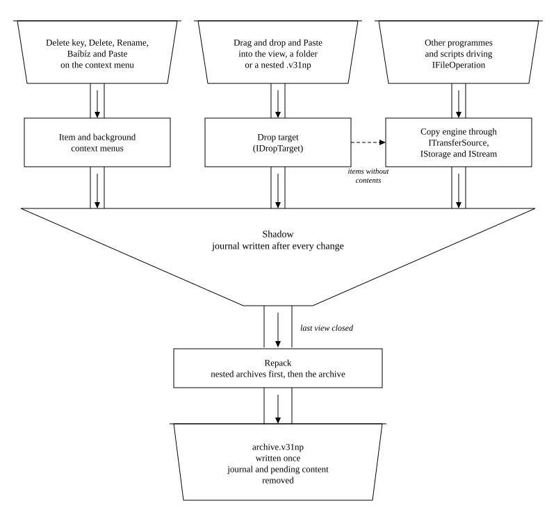

Figure Ú-1 Paths by which Explorer Reaches the Extension

The folder of an archive implements IShellFolder2 and IPersistFolder3. Its view is created with SHCreateShellFolderView, and an IShellFolderViewCB is handed to it in SFV_CREATE for one purpose: the release of that callback marks the closing of the view, by which the views of § ( G/( ż ) ) are counted. An enumeration requested with SHCONTF_STORAGE (0x800) shall return folders and files alike. Table Ú-3 presents the attributes reported for items. A drop onto the icon of a nested archive requires SFGAO_DROPTARGET on the item and an IDropTarget for it from GetUIObjectOf, directed at the nested archive.

<table id="table-ú-3">
<caption>Table Ú-3 Attributes of Items</caption>
<thead>
<tr><th>Item</th><th>Attributes (SFGAO_)</th></tr>
</thead>
<tbody>
<tr><td>File</td><td>STREAM, CANCOPY, CANMOVE, CANRENAME, CANDELETE</td></tr>
<tr><td>Nested .v31np</td><td>As a file, with FOLDER and DROPTARGET</td></tr>
<tr><td>Folder</td><td>FOLDER, HASSUBFOLDER, DROPTARGET, CANCOPY, CANMOVE, CANRENAME, CANDELETE</td></tr>
<tr><td>The folder itself, no item selected</td><td>FOLDER, HASSUBFOLDER, DROPTARGET</td></tr>
</tbody>
</table>

The context menu of items is built with SHCreateDefaultContextMenu and a callback. Delete arrives as DFM_CMD_DELETE, with the verb delete, and Paste as DFM_CMD_PASTE; neither passes through the copy engine, and neither asks. Explorer may invoke an entry by its canonical verb, taken from GetCommandString, instead of by its menu identifier, and both shall be handled; a verb that is not recognised falls into the default path of the menu, which opens copies of the files in their applications and reports an error for each. Baíbíz carries the verb v31np.pack. Entries with the verbs Windows.ModernShare and Windows.Share are removed inside archives.

Table Ú-4 presents the data the drop target receives and its treatment, and Figure Ú-2 shows how a move is reported to its source. The last row of the table and the lower part of the figure give the reverse case, a move out of an archive onto the disk, which the drop target of Explorer reports to the extension. Moves from disk and between archives of the extension are optimised moves: the extension does the work itself and reports CFSTR_PERFORMEDDROPEFFECT as DROPEFFECT_NONE, so that the source keeps its files, which are deleted only by the repack. Until then, each original moved in at the top of the move is hidden with FILE_ATTRIBUTE_HIDDEN and recorded as a row H, and each change of the attribute is announced through SHChangeNotify with SHCNE_ATTRIBUTES and SHCNE_UPDATEDIR on the folder that holds the original; where Explorer is set to show hidden files, the original is still shown, faded. CFSTR_PASTESUCCEEDED with DROPEFFECT_MOVE shall never be reported for sources on disk, since the clipboard object of Windows takes it as the order to delete the originals at once, before the repack has read them. Foreign virtual sources, such as zip folders and devices, are unoptimised moves: the extension reports DROPEFFECT_MOVE, on Paste also CFSTR_PASTESUCCEEDED, and the source deletes its items. On Paste, a move is recognised by CFSTR_PREFERREDDROPEFFECT. From every source, an item whose name is already taken receives a suffix as set out in § ( G/( ù ) ).

<table id="table-ú-4">
<caption>Table Ú-4 Data Received by the Drop Target</caption>
<thead>
<tr><th>Source</th><th>Formats</th><th>Treatment</th><th>Reported on a move</th></tr>
</thead>
<tbody>
<tr><td>Disk</td><td>CF_HDROP</td><td>Rows F; on a move rows M, R for each folder, and H for each original hidden</td><td>CFSTR_PERFORMEDDROPEFFECT: DROPEFFECT_NONE</td></tr>
<tr><td>Archives of the extension</td><td>CFSTR_SHELLIDLIST, resolved to archive, level and path</td><td>Rows moved, or copied out as in Table G-7</td><td>CFSTR_PERFORMEDDROPEFFECT: DROPEFFECT_NONE</td></tr>
<tr><td>Zip folders, devices and other virtual sources</td><td>CFSTR_SHELLIDLIST with CFSTR_FILEDESCRIPTORW and CFSTR_FILECONTENTS, the contents as IStream or HGLOBAL</td><td>Contents copied to rows T, folders recorded as rows D</td><td>CFSTR_PERFORMEDDROPEFFECT: DROPEFFECT_MOVE; on Paste also CFSTR_PASTESUCCEEDED: DROPEFFECT_MOVE</td></tr>
<tr><td>Other shell items</td><td>CFSTR_SHELLIDLIST alone</td><td>Handed to IFileOperation</td><td>Left to the copy engine</td></tr>
<tr><td>Out of an archive onto the disk, received by the drop target of Explorer</td><td>CFSTR_FILEDESCRIPTORW and CFSTR_FILECONTENTS, offered by the data object of the extension</td><td>Items read to the end removed through the shadow, as by Delete; the rest kept</td><td>Reported to the extension through SetData: CFSTR_PERFORMEDDROPEFFECT: DROPEFFECT_MOVE; on Paste also CFSTR_PASTESUCCEEDED: DROPEFFECT_MOVE</td></tr>
</tbody>
</table>

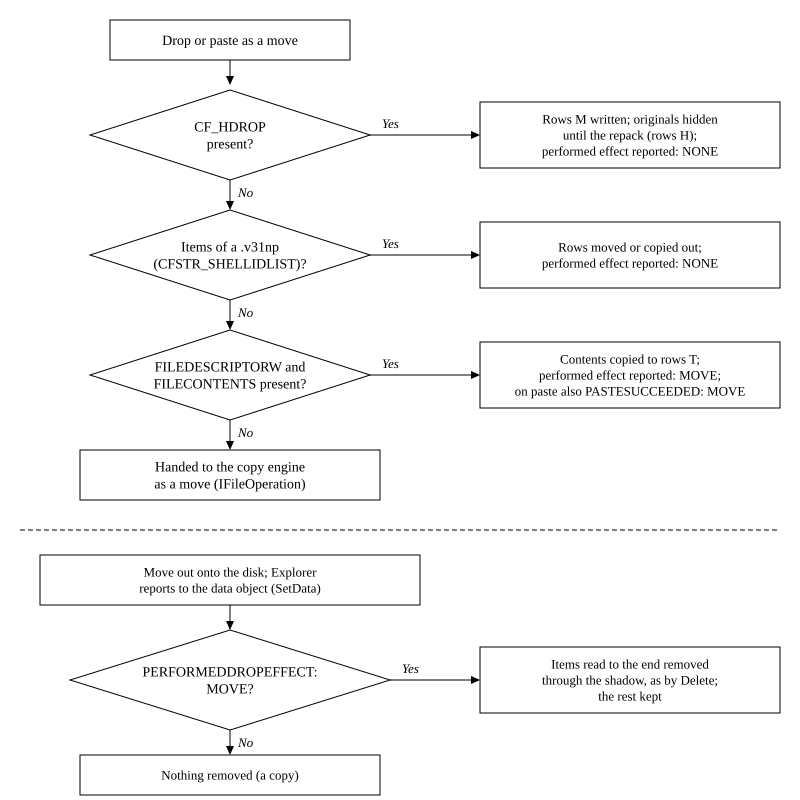

Figure Ú-2 Report of a Move to the Source

Items copied or dragged out of an archive are offered as CFSTR_FILEDESCRIPTORW and CFSTR_FILECONTENTS by a data object wrapped with SHCreateDataObject. The drop target of Explorer on the disk takes these formats for copies and for moves alike: it names the files itself from cFileName, shows its own dialogs Copy File and Confirm Folder Replace where a name is taken, and does not use the source interface described below, so that the suffix of § ( G/( ù ) ) does not apply there. The formats are offered nonetheless, since programmes that accept only virtual files, such as web browsers receiving an upload, would otherwise receive nothing. The data object is never told its destination, and FILEDESCRIPTORW has no means to rename an item on a clash. After a move, the drop target reports it to the data object with CFSTR_PERFORMEDDROPEFFECT set to DROPEFFECT_MOVE, and on a paste also with CFSTR_PASTESUCCEEDED; the data object of the extension, behind SHCreateDataObject, receives the report through SetData, and the extension then removes the moved items from the archive through the shadow, by the same path as the Delete key. Only items that reached the disk are removed: a file counts as written once Windows has read its CFSTR_FILECONTENTS stream to the end, and an empty file once its stream has been requested; a folder is removed only when all its files were read, and otherwise only its read files are removed, the rest staying with the folder. Items skipped in the dialogs of Windows, or not written since the operation was cancelled, stay in the archive. A copy reports no move and removes nothing.

The extraction commands of Table Ú-1 hand the items of the archive to the copy engine themselves, through IFileOperation::CopyItems onto the destination folder, with the window of Explorer as owner. The engine asks GetDefaultDestinationName of the source interface for each item, from the top down, with the real destination folder, and receives the names of § ( Ú/( b.i.4. ) ); for a folder that lands on a folder it receives the same name, merges the two, and asks again for each item inside. No dialog is shown.

The copy engine finds its source through IShellFolder::CreateViewObject with ITransferSource, not through BindToObject. Table Ú-5 presents the methods of ITransferSource. OpenItem returns S_FALSE for files and folders, which tells the engine to open them itself: it then enters folders through BindToObject with IStorage and reads files through BindToObject with IStream, as it does for the zip folder of Windows. The resources of IShellItemResources are not used: the resource that holds the content of a file has no documented identifier, the folders of Windows list none, and an engine given resources copies every file with 0 bytes.

<table id="table-ú-5">
<caption>Table Ú-5 Methods of ITransferSource</caption>
<thead>
<tr><th>Method</th><th>Behaviour</th></tr>
</thead>
<tbody>
<tr><td>OpenItem</td><td>Returns S_FALSE for files and folders</td></tr>
<tr><td>RemoveItem</td><td>As shown in Figure Ú-3; an item already gone returns S_OK</td></tr>
<tr><td>RecycleItem</td><td>As RemoveItem, since an archive has no Recycle Bin</td></tr>
<tr><td>MoveItem</td><td>E_NOTIMPL; the engine then copies and calls RemoveItem</td></tr>
<tr><td>RenameItem</td><td>Renames and returns the new IShellItem</td></tr>
<tr><td>GetDefaultDestinationName</td><td>Returns the name naturalised for Windows; where the destination already holds it, the name with a suffix of Table G-2, except for a folder landing on a folder, which keeps its name and is merged; shortened as in § ( Ú/( b.i.4. ) ) where long paths are disabled</td></tr>
<tr><td>LinkItem, ApplyPropertiesToItem</td><td>E_NOTIMPL</td></tr>
<tr><td>Advise, Unadvise, SetProperties, EnterFolder, LeaveFolder</td><td>S_OK</td></tr>
</tbody>
</table>

The engine asks for the removal of a folder before it touches the items inside it, as shown in Figure Ú-3. On a delete, where the flag TSF_MOVE_AS_COPY_DELETE (0x400) is not set, the extension removes the folder with all it holds and returns COPYENGINE_S_DONT_PROCESS_CHILDREN; with S_OK, the engine would look for the items just removed and fail with 0x80070002. On a move, where the flag is set, the items have not yet been copied: the extension returns S_OK, marks the folder and keeps everything, and removes the folder once its last item has moved out. A folder removed at once loses every file of the move, and an answer of ERROR_DIR_NOT_EMPTY makes the engine abort. A folder that is emptied in any other way remains as a row D, since a folder that vanishes with its last item breaks the engine as well.

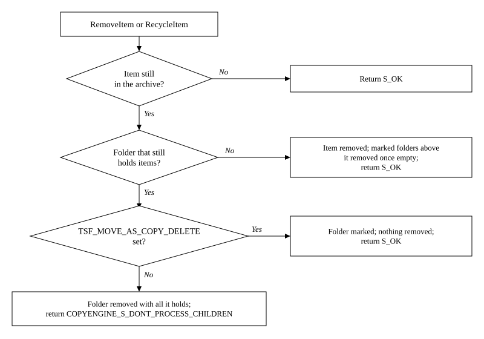

Figure Ú-3 Removal Requested by the Copy Engine

As a destination, the extension offers no ITransferDestination, for the reason given above; the engine then writes through IStorage, which the folder of an archive provides through QueryInterface and BindToObject. Figure Ú-4 shows the writing of a file. CreateStream(name) shall list the new item at once, as a row T on an empty temporary file; Commit and Stat follow, and Stat on the stream shall report the name of the element and not the name of the temporary file. The engine releases the stream without writing to it, finds the item with ParseDisplayName, and binds it with IStream three times, with the modes 0, 0x20 and 0x22, the last being STGM_READWRITE with STGM_SHARE_DENY_WRITE. The content arrives through the last bind, so that a bind in a mode that permits writing shall hand out a writable stream on the same temporary file. A folder is created with CreateStorage(name), which records a row D; Commit and Stat follow, ParseDisplayName shall find the new empty folder at once, and BindToObject with IStorage opens it for the files that follow. DestroyElement, RenameElement and MoveElementTo are supported as well. Names already taken in writes through IStorage are left to the clash handling of Windows, as permitted in § ( G/( ù ) ).

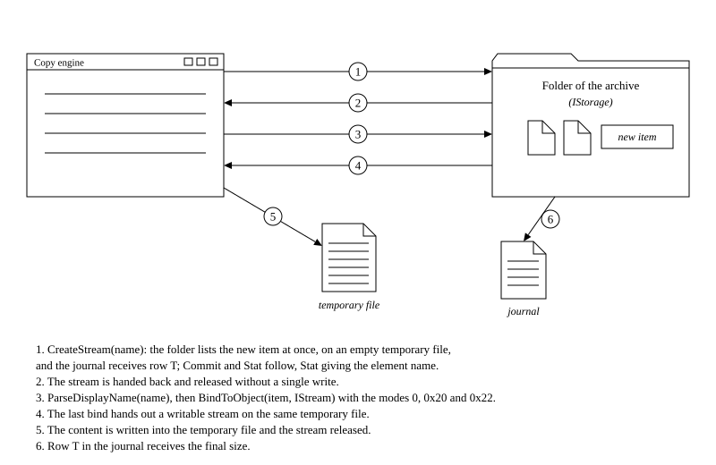

Figure Ú-4 Writing a File through IStorage

IFileOperation directed at the root of an archive fails with 0x8007007B before the extension is asked, since to Windows the root is a file; the zip folder of Windows fails in the same way. Drop and Paste into the root pass through the drop target and are not affected. The Delete key of Explorer does not use the copy engine and asks nothing, while programmes that delete through IFileOperation receive the confirmation that Windows shows for items that cannot be recycled, which an extension cannot suppress.

Windows does not show its New menu inside a namespace extension, even where a key Background\shellex\ContextMenuHandlers\New is handed to SHCreateDefaultContextMenu. The extension therefore hosts the New menu of Windows itself, CNewMenu, {D969A300-E7FF-11D0-A93B-00A0C90F2719}, as shown in Figure Ú-5. It mirrors the names of the folder of the archive into a private temporary folder in %TEMP%\v31np as empty placeholders, so that Windows numbers new names correctly, initialises the New menu on that folder, lets it fill the menu, and renames its popup to Ípmùk. Once Windows has created an item there, the extension moves it into the archive and opens its name field through IShellBrowser, QueryActiveShellView and SelectItem with SVSI_EDIT. New Shortcut writes a placeholder .lnk, which is not empty, and starts a wizard that completes it later; a new .lnk is therefore taken only once it has been changed, renamed or removed, and the folder is watched for ten minutes.

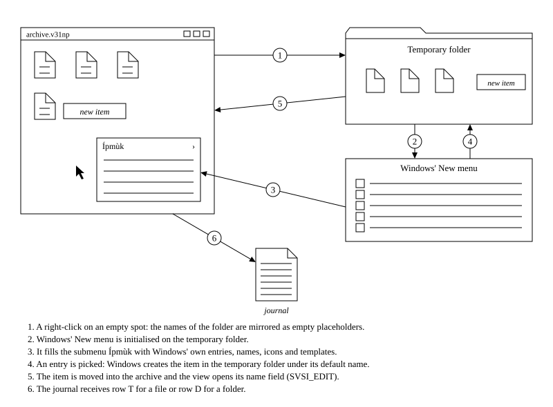

Figure Ú-5 Creating an Item with Ípmùk

The lock of § ( G/( z ) ) is a named mutex, Local\v31np- followed by the 64-bit FNV-1a hash of the path of the archive, in upper case and UTF-16, as 16 hexadecimal digits. The journal is written to its name with .tmp appended, moved over the journal with MoveFileEx, MOVEFILE_REPLACE_EXISTING and MOVEFILE_WRITE_THROUGH, and given FILE_ATTRIBUTE_HIDDEN. The extension writes only the plain name, and looks for the journal under both names of § ( G/( d ) ): where one exists, it is used; where both hold the same bytes, the plain one is used; where they differ, the one that can be read is used, and where both or neither can be read, the one with the later ftLastWriteTime. The repack and the discard of a stale journal delete only the journal that was used. The time in its header is the ftLastWriteTime of the archive. The repack writes the new archive to a temporary file beside it and replaces the archive through SetFileInformationByHandle with FileRenameInfoEx, FILE_RENAME_FLAG_REPLACE_IF_EXISTS and FILE_RENAME_FLAG_POSIX_SEMANTICS, so that readers holding the old file open are not disturbed; where that fails, MoveFileEx is used. After each change and after the repack, SHChangeNotify with SHCNE_UPDATEITEM refreshes the views.

### ( ii ) 7-Zip

The 7-Zip plugin, v31np.dll, adds .v31np as a format to 7-Zip 26.05. It is built for x86, x64 and ARM64 and is placed in the Formats folder of 7-Zip by baíbúočman.exe, a 32-bit 7-Zip on 64-bit Windows receiving the x86 build. The plugin carries the medallion PASSING (see § ( U )).

The plugin registers the format name v31np and the extension v31np, and recognises a file by its magic followed by π. Folders are built from the keys, and each item reports its path, whether it is a folder, and its size. Folders are sorted before files, and names are sorted in V31N order as in § ( G/( b ) ).

7-Zip lists names as they are stored. On extraction, the plugin reports names naturalised and made unique as described in § ( Ú/( b.i.4. ) ), while the length of paths is left to 7-Zip. Extraction does not verify the checksum. A test verifies the checksum over the whole archive and, on a mismatch, reports CRC Failed for every file, since the checksum does not cover single files (see § ( B/( a.v. ) )).

The plugin reads the journal of § ( G/( d ) ) through IArchiveOpenVolumeCallback, as shown in Figure Ú-6. It takes the name and the last-write time of the archive from GetProperty with kpidName and kpidMTime, and opens the journal under both names through GetStream, choosing between them as the extension does (see § ( Ú/( b.i.5. ) )), the write time of each being taken from IStreamGetProps::GetProps on its stream; where no time is given, the plain name prevails on a tie. Where the journal is readable and matches the archive, 7-Zip lists and extracts the archive with its pending changes, among them files linked on disk, empty folders, and nested archives built from their sections, as set out in § ( G/( i ) ). The plugin does not discard a stale journal; it reads the archive as stored.

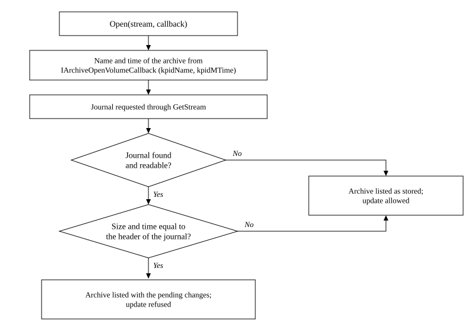

Figure Ú-6 Opening an Archive in 7-Zip

The plugin supports update when no journal exists, by which files may be added, replaced, renamed and deleted; the archive is rewritten in full. While a journal exists, update is refused, since 7-Zip always writes a whole new archive itself and cannot write into the shadow. A backslash in a path given by 7-Zip is converted to /. Dates and attributes are ignored, and empty folders, invalid UTF-8 and duplicate keys are refused.

# ( U ) V31NP STANDARD

The V31NP STANDARD is the format as defined in § ( B ). Each programme described in § ( Ú ) carries one of two medallions, which state whether the programme conforms to the standard.

The medallion PASSING is carried by a programme of which every .v31np file it writes conforms to § ( B/( a ) ), and which reads every file that conforms. The medallion FAILING is carried by a programme that writes or keeps at least one .v31np file that does not conform to § ( B/( a ) ), or that refuses a file that conforms. Medallions are awarded by v31n after review, by its own decision, and are informational. A programme is rated against § ( G ) only for the functions it offers; a programme that only writes .v31np files, for example, is not expected to present or edit them. Table U-1 presents the medallion carried by each programme described in § ( Ú ).

<table id="table-u-1">
<caption>Table U-1 Medallions</caption>
<thead>
<tr><th>Programme</th><th>Section</th><th>Medallion</th></tr>
</thead>
<tbody>
<tr><th colspan="3">Native Systems</th></tr>
<tr><td>Secura</td><td>§ ( Ú/( a.i. ) )</td><td>PASSING</td></tr>
<tr><td>M2</td><td>§ ( Ú/( a.ii. ) )</td><td>PASSING</td></tr>
<tr><td>V31null Hub</td><td>§ ( Ú/( a.iii. ) )</td><td>FAILING</td></tr>
<tr><th colspan="3">External Third Parties</th></tr>
<tr><td>Windows Explorer extension</td><td>§ ( Ú/( b.i. ) )</td><td>PASSING</td></tr>
<tr><td>7-Zip plugin</td><td>§ ( Ú/( b.ii. ) )</td><td>PASSING</td></tr>
</tbody>
</table>

# ( Ù ) CONSIDERATIONS

## ( a ) Introduction

The properties of the format described in § ( B ) carry costs as well as benefits. These costs are deliberate and follow from the purposes set out in § ( A/( g ) ). The format leaves the use of these properties to the developer, who is responsible for the design of the files written and should exercise judgment in applying the format to a given purpose. The considerations of this division are provided to that end.

## ( b ) Rewriting and Storage

Since every address depends on the length of the header and the checksum covers the whole file, a .v31np file cannot be updated in place (see § ( B/( b.ii. ) )). Any change, whether a file is added, replaced, renamed or deleted, writes the whole file again. A file of 50 GB is therefore written again in full, all 50 GB, even when a single byte or a single key changes. The 7-Zip plugin and M2 write the new file beside the old one for each change and then replace it, so that free space at least equal to the length of the new file is required for the duration of the change. The Windows Explorer extension records changes in a shadow and writes the archive once, when the user leaves it (see § ( G/( ż ) )), so that any number of changes costs a single rewrite; the free space is required at that moment, and the journal and temporary files hold the pending content until then. Figure Ù-1 shows the sequence of a change to a file inside a nested archive.

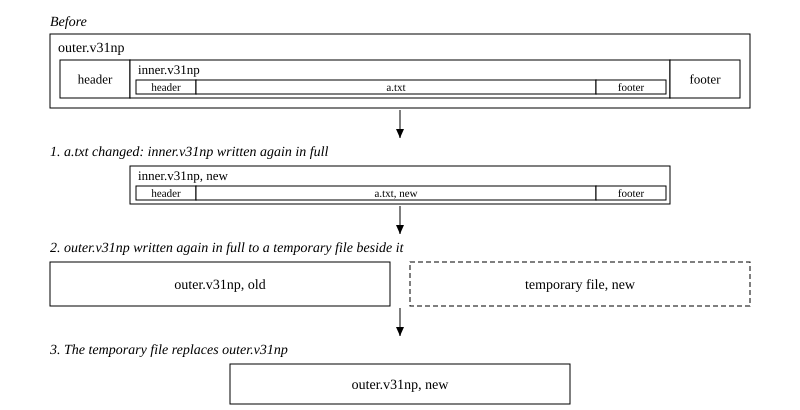

Figure Ù-1 Rewriting on Change

Large files that are rewritten repeatedly tend to become fragmented, as the new copy is placed in whatever free space the drive holds at the time. On a hard disk drive, fragmentation slows reading. On a solid-state drive, fragmentation has little effect on reading, but each rewrite writes the full length of the file again.

This cost is offset by the absolute addresses of the format, by which any file is read at its address without decoding, and a file is streamed, resumed and read by byte range. The format is therefore best suited to files that are written once and read many times. Files that change often should be kept apart from files that rarely change, so that archives that are edited remain small.

## ( ú ) Compression

The data of each file is stored raw (see § ( B/( b.ii. ) )). The extracted size of each file therefore equals its stored size, which blocks zip bombs, and each file can be read at its address without decoding. The absence of compression is offset by this direct read access and by the use of the format for general storage.

Most files shared today are already compressed by their own formats, such as images, audio and video, and compressing them again gains little. The developer should therefore optimise the input before packing it, choosing for each file a format that is already compressed where size matters.

## ( u ) Nested Archives

Packing files into a zip or another compressed archive and then storing that archive as a single file in .v31np is strongly discouraged. The header then describes only the outer file, so that the addresses and sizes of the files inside it are not known, they cannot be read by byte range, and their extracted size is no longer bounded by the header. The benefits of the format, and its protection against zip bombs, then no longer apply to those files.

A .v31np file may be stored inside another, and keeps these properties, since its data is raw as well. A change to a nested archive, however, rewrites each archive that contains it (see § ( G/( ż ) )); the Windows Explorer extension does so once for each visit of the archive.

## ( ù ) Metadata

Dates, permissions, owners and attributes are not stored (see Table B-7). The omission is intended: .v31np is a format for storing and sharing the contents of files. Where an application requires such information, it should store it as a file inside the archive, in a format of its own choosing.

## ( g ) The Marks π and φ

It may be supposed that a reader which searches for π and φ could find them in the wrong place, for example inside the data of a file. A reader searches for the marks only within the header. The magic is followed by π, the next π closes T1, and the next closes T2. As shown in § ( B/( b.i. ) ), neither mark can occur inside a key or a number, so that the first π found after the rows of a table is always the π that closes it, and the same holds for φ within the rows.

The data is not searched. Once the header has been read, each file is read at its address for its size, and the footer is read at its fixed position in the last 16 bytes of the file. A π or a φ inside the data of a file, as in any .v31np file stored inside another, is therefore harmless, and a reader has no need to search beyond the header. Figure Ù-2 illustrates what a reader searches and what it reads.

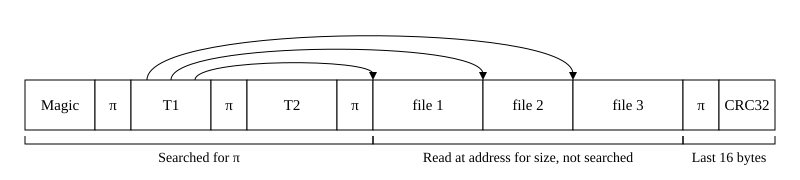

Figure Ù-2 Reading a File

## ( d ) The Checksum

The checksum is a quick check of the whole file. It does not establish the authenticity of a file, nor who wrote it, nor that it has not been altered on purpose. The format was created for exchange between two parties, and the checksum allows them to compare their copies of a file, in the manner of a client asking a server whether its file matches the server's.

The checksum comes last, so that a client downloading a file can check the last bytes it holds. Where the closing π and the checksum are missing, the download is incomplete, and the client resumes it by byte range from the length it already holds. Figure Ù-3 shows the exchange between a client and a server.

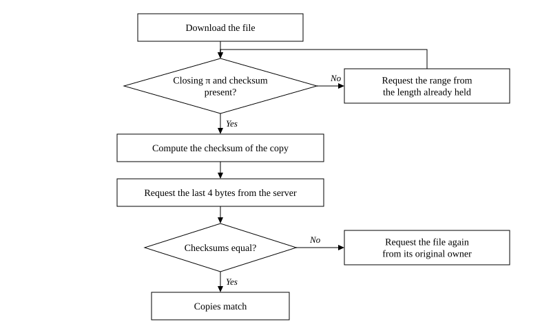

Figure Ù-3 Download and Comparison between Client and Server

A mismatch indicates that the file differs from the file that was written, without showing which file inside it differs (see § ( B/( a.v. ) )). The file should then be requested again from its original owner where that is possible. Where every file inside can be confirmed correct by other means, such as against the copy of the owner or against fingerprints, the archive may be rewritten with a new checksum.

## ( e ) Networking

Since the header precedes the data and gives the address and size of every file, a client need not fetch a whole .v31np file. It may fetch the header alone, offer the files it lists, and fetch each chosen file by byte range from its address for its size. Figure Ù-4 shows this exchange.

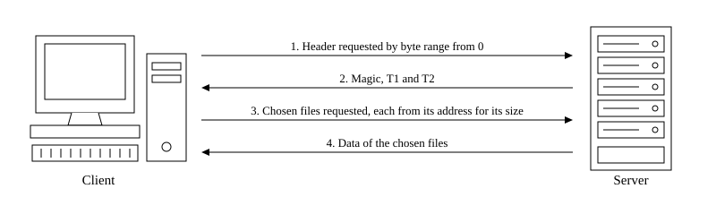

Figure Ù-4 Selective Download

A client that already holds a copy may check whether it is current without fetching the file again. A local copy may carry a checksum that matches its own bytes while its data is stale, so that the copy is compared with that of the server rather than with itself. The server sends its header and its checksum, and the client compares them with those of its copy.

Where they differ, the format allows two courses, and the developer chooses between them. The client may be given agency: it compares the two headers and requests by byte range the files that are missing or of another size, and the whole file where the headers match but the checksums differ. Alternatively, the server may decide, answering that the whole file will be sent since it is small, or that the client shall name the ranges it requires. Figure Ù-5 shows both courses.

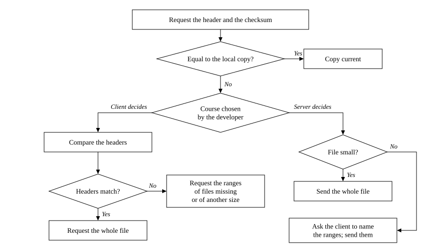

Figure Ù-5 Checking a Copy

# ( G ) CONFORMING BEHAVIOUR

## ( a ) Introduction

This division sets out the behaviour required of programmes that present, extract or edit .v31np files, on any operating system. Programmes on different systems shall behave alike, so that a user meets the same results everywhere, and an archive with pending changes passes between programmes unharmed. A programme is bound by a part of this division only where it offers the function concerned; a programme that only writes .v31np files, such as a packer in a browser, is not required to present or edit them.

The requirements of this division are stated with shall, and each binds unless this document states otherwise. A requirement binds the result and not the means. The names and wording of commands, the menus that carry them, the interfaces of the system through which they are carried out, and values such as the length of a wait are left to the programme. The means by which the Windows Explorer extension and the 7-Zip plugin meet these requirements are described in § ( Ú/( b ) ).

## ( b ) Browsing

A programme shall present a .v31np file as a folder, and a .v31np file stored inside another as a folder in turn. Folders exist as the prefixes of keys (see § ( B/( b.ii. ) )); in addition, empty folders recorded in a journal (see § ( G/( d ) )) shall be presented until the repack. Names shall be presented as they are stored in the key, since the rules of § ( G/( ú ) ) apply only when files leave the archive. The size of each file shall be presented as stored, and the size of a nested archive with pending changes as the length it will have after the repack (see § ( G/( i ) )). A file opened from inside an archive shall open in the application that the system associates with its type.

Folders shall be listed before files, and the names within each group shall be sorted in V31N order. Two names are compared first without their extensions, the extension being the part from the last full stop of the name where that full stop is not its first character; where the names are equal in that comparison, the whole names are compared. Before the comparison, each name is folded in five steps, shown in Figure G-1, as follows:

1. White space at the start is skipped, and where the name then begins with [ and a ] follows with at least one character between them, the text between the brackets replaces the name.
2. Punctuation and white space at the start are removed.
3. The name is decomposed to Unicode normalisation form D, each character followed by a combining diaeresis (U+0308) is written twice and the diaeresis dropped, and the result is composed again to form C, so that Ä becomes AA.
4. The sign № followed by digits, with or without white space between them, is written as № and the digits without leading zeros, padded with zeros to five digits.
5. The name is written in lower case.

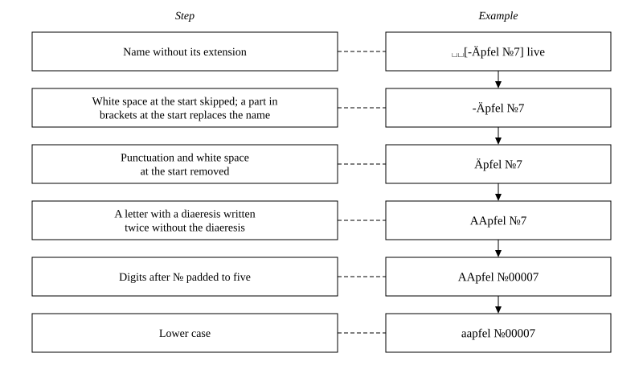

Figure G-1 Folding of a Name

The folded names are compared character by character, as shown in Figure G-2. Equal characters are passed over. Where both characters are listed in Table G-1, the one of lower rank comes first, and characters of equal rank are passed over as equal. A character listed in Table G-1 comes before one that is not, and two characters that are not listed are ordered by their code points. Where one name ends before a difference is found, the shorter comes first.

<table id="table-g-1">
<caption>Table G-1 Ranks of V31N Order</caption>
<thead>
<tr><th>Rank</th><th>Characters</th><th>Rank</th><th>Characters</th></tr>
</thead>
<tbody>
<tr><td>0 to 9</td><td>The digits 0 to 9, each of its own value</td><td>24</td><td>m м</td></tr>
<tr><td>10</td><td>a а</td><td>25</td><td>n н</td></tr>
<tr><td>11</td><td>b б</td><td>26</td><td>o о</td></tr>
<tr><td>12</td><td>ú v в</td><td>27</td><td>p п</td></tr>
<tr><td>13</td><td>u у</td><td>28</td><td>r р</td></tr>
<tr><td>14</td><td>ù w</td><td>29</td><td>s с</td></tr>
<tr><td>15</td><td>g г</td><td>30</td><td>t т</td></tr>
<tr><td>16</td><td>d д þ</td><td>31</td><td>f ф</td></tr>
<tr><td>17</td><td>e е э</td><td>32</td><td>ț ц</td></tr>
<tr><td>18</td><td>ż j ж</td><td>33</td><td>č ч</td></tr>
<tr><td>19</td><td>z з</td><td>34</td><td>ș ш</td></tr>
<tr><td>20</td><td>i и</td><td>35</td><td>c</td></tr>
<tr><td>21</td><td>í y й</td><td>36</td><td>q</td></tr>
<tr><td>22</td><td>k к</td><td>37</td><td>x</td></tr>
<tr><td>23</td><td>l л</td><td>38</td><td>h х ‘</td></tr>
</tbody>
</table>

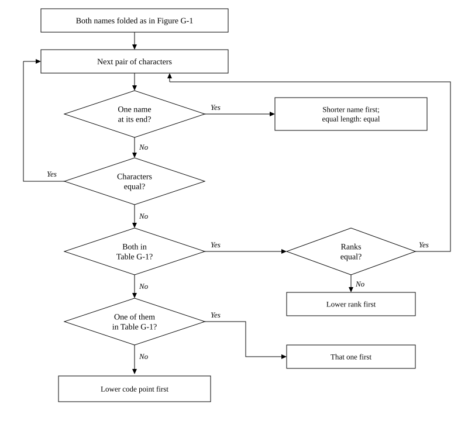

Figure G-2 Comparison of Two Names

## ( ú ) Extraction

A programme that writes the files of an archive to its system shall derive from each part of a key a name that the system permits, by rules that suit that system; the rules applied on Windows are given in Table Ú-2. The key in the archive shall not be changed, and no extension shall ever be added. Where two names in one folder are equal by the comparison of the system, the first shall keep its name, and each later one shall receive a suffix before its extension, which begins at the last full stop of the name. A name without a full stop shall receive the suffix at its end, and a name whose only full stop is its first character shall receive it at its start, so that .gitignore becomes a.gitignore. A name that is already taken at the destination, by the comparison of the system, shall not be replaced, and the programme shall not ask: a file, and a folder landing on a file, shall receive a suffix in the same manner, while a folder landing on a folder of the same name shall be merged with it, so that only the clashing files inside it receive suffixes. Where the writing of the files is handed to the copy machinery of the system, names already taken are decided as set out in § ( G/( ù ) ). A path that exceeds the length the system permits shall be shortened by the rules of that system, the extension being kept. Extracted files shall carry the date of extraction, and the checksum shall not be verified on extraction. Figure G-3 shows the naming of an extracted file.

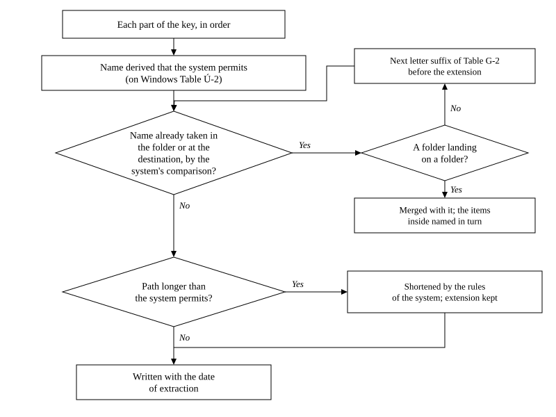

Figure G-3 Naming of Extracted Files

The suffixes shall be the same on every system and shall be taken in the order of Table G-2. They are counted in the manner of the columns of a spreadsheet, with the 29 letters of the table as digits and no zero: after h follow aa to ah, then ba to bh, and so on to hh, after which aaa follows. The same suffixes shall be given to a new archive or folder whose name is already taken (see § ( G/( u ) )), to an item added to an archive under a name already taken, and to a copy made into the folder it comes from (see § ( G/( ù ) )).

<table id="table-g-2">
<caption>Table G-2 Letter Suffixes</caption>
<thead>
<tr><th>Number of the later name</th><th>Suffix</th><th>Example for photo.jpg</th></tr>
</thead>
<tbody>
<tr><td>1 to 29</td><td>a, b, ú, u, ù, g, d, e, ż, z, i, í, k, l, m, n, o, p, r, s, t, f, ț, č, ș, c, q, x, h</td><td>photoa.jpg to photoh.jpg</td></tr>
<tr><td>30 to 58</td><td>aa to ah</td><td>photoaa.jpg to photoah.jpg</td></tr>
<tr><td>59 to 87</td><td>ba to bh</td><td>photoba.jpg to photobh.jpg</td></tr>
<tr><td>842 to 870</td><td>ha to hh</td><td>photoha.jpg to photohh.jpg</td></tr>
<tr><td>871</td><td>aaa</td><td>photoaaa.jpg</td></tr>
</tbody>
</table>

## ( u ) Commands

A programme that integrates .v31np files into a file manager shall offer the functions of Table G-3. Their names, and the menus that carry them, are left to the programme; the names used on Windows are given in Table Ú-1. In the table, the name of an archive means its file name without .v31np. Where a folder baíbíz e alùz, or an archive of the name chosen when packing, already exists, the new one shall receive a suffix of Table G-2.

<table id="table-g-3">
<caption>Table G-3 Commands</caption>
<thead>
<tr><th>Function</th><th>Selection</th><th>Result</th></tr>
</thead>
<tbody>
<tr><td>Extract into a folder of the name of the archive</td><td rowspan="4">One .v31np file</td><td>Files written into a new folder of that name beside the archive</td></tr>
<tr><td>Extract here</td><td>Files written into the folder of the archive</td></tr>
<tr><td>Extract into a picked folder</td><td>Files written into a folder picked by the user</td></tr>
<tr><td>Extract into a folder of the name of the archive inside a picked folder</td><td>Files written into a new folder of that name inside a folder picked by the user</td></tr>
<tr><td>Extract several here</td><td rowspan="2">Several .v31np files</td><td>Each archive extracted into a folder of its name inside a new folder baíbíz e alùz in the folder of the archives</td></tr>
<tr><td>Extract several into a picked folder</td><td>Each archive extracted into a folder of its name inside a new folder baíbíz e alùz in a folder picked by the user</td></tr>
<tr><td rowspan="2">Pack</td><td>Files and folders of the system</td><td>A new .v31np file beside the selection, named after its first item, a file without its extension; the selection is copied</td></tr>
<tr><td>Files and folders inside an archive</td><td>A new .v31np file in the same folder, named in the same manner; the selection is moved into it</td></tr>
<tr><td>Create an archive</td><td>None, in a folder of the system</td><td>An empty .v31np file, as in Table B-6</td></tr>
<tr><td>Create inside an archive</td><td>None, inside an archive</td><td>A new item of any type that the system can create, ready to be named at once</td></tr>
</tbody>
</table>

An extraction never replaces what the destination already holds; names already taken there receive a suffix of Table G-2, and folders are merged, as set out in § ( G/( ú ) ).

## ( ù ) Editing

The functions that a programme that edits archives shall allow, inside an archive and inside every archive nested in it, are as follows:

1. Adding files and folders from the system, by copy and by move.
2. Copying and moving within one archive, between archives, between nested levels, and onto a nested archive.
3. Copying and moving out of an archive onto the system.
4. Renaming.
5. Deleting.
6. Creating new items.
7. Packing a selection into a new archive (see Table G-3).

A move out of an archive onto the system shall, where applicable, remove from the archive only the items that have reached the system, and shall remove them through the shadow in the manner of a delete. Items that were skipped or not written, as where the move is cancelled, stay in the archive.

An item added to an archive shall, where applicable, never replace an entry of the same name, and the programme shall not ask. A clash is determined on the key, compared exactly as stored, level by level as the folder presents it, so that a leading / and empty parts of a key are disregarded. A file that lands on a file or on a folder of the same name shall receive a suffix of Table G-2, as eayk.png becomes eayka.png and then eaykb.png, and a folder that lands on a file shall receive a suffix and keep all it holds. A folder that lands on a folder of the same name shall be merged with it, and only the clashing files inside it shall receive suffixes; empty folders follow the same rules. These rules apply to every way in, namely copy and move from the system, from another archive or another level, from sources without files on the system, and to another folder of the same level. An item copied into the folder it comes from shall receive a suffix as well, and a folder so copied shall become a new folder of that name with the suffix, holding a full copy, and shall not be merged into itself; an item moved onto its own place is left as it is.

Where the writing of files, into an archive or out of it, is handed to the copy machinery of the system, that machinery decides on names already taken, and the rules of this part and of § ( G/( ú ) ) on such names do not apply to that writing. On Windows, this is the case for a drag or a paste out of an archive onto the disk, and for programmes that write into an archive through the copy engine (see § ( Ú/( b.i.5. ) )).

The programme itself shall not ask for confirmation before deleting; users are presumed to know what they do. A rename shall be refused where the new name is empty, contains / or is already used in the folder, and a folder shall not be moved into itself or into a folder inside it.

Since a .v31np file cannot be updated in place (see § ( B/( b.ii. ) )), changes shall not be written to the archive one by one. Each change shall be recorded in a shadow, as set out in § ( G/( g ) ), and the archive shall be written once, when the user leaves it. A change shall be visible at once in every view of the archive and to every programme that reads through the journal.

## ( g ) The Shadow

The shadow is the state of an archive together with its pending changes. It consists of the archive on disk, a journal beside it (see § ( G/( d ) )), and the content to which the journal refers, namely files on the system that were added as links and temporary files holding content that has no place on the system. The archive itself shall not be touched until the repack (see § ( G/( ż ) )).

Every change shall run as shown in Figure G-4, as follows:

1. The programme takes a lock of the archive that excludes every other programme changing the same archive (see § ( G/( z ) )).
2. It reads the journal and discards it if it is stale.
3. It applies the change to the sections of the journal.
4. It writes the journal whole.
5. It releases the lock.

Views and readers then present the new state. When the last view of the archive closes and no view opens again within a short wait, the programme shall repack the archive.

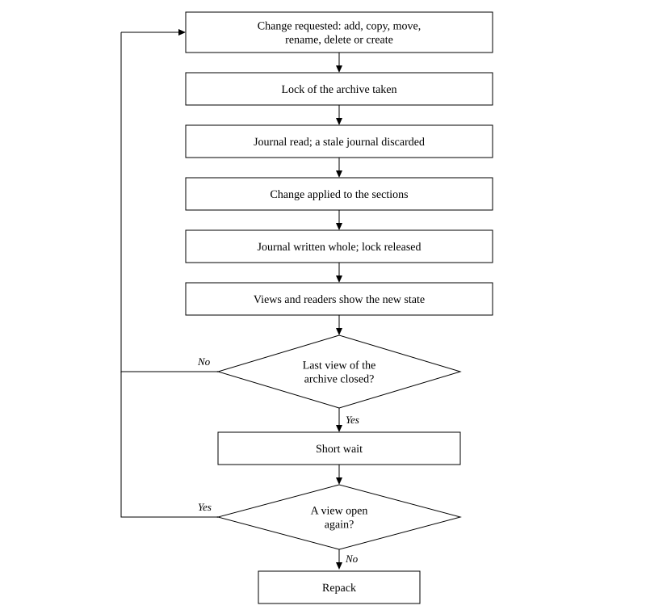

Figure G-4 Life of a Change

A file added from the system shall not be copied. The journal shall refer to it, and it shall be read at the repack. A file moved in from the system shall stay where it is until the repack, after which it shall be deleted. Meanwhile the original shall not be presented on the system, where the system provides a means of hiding files: the programme shall hide each item moved in at the top of the move, a folder as a whole without the files inside it, and shall record it in the journal as a row H in the section of the level into which it was moved (see Table G-6). An original that was hidden already shall not be recorded and shall never be touched. After every change, a row H whose path is no longer referred to by any row M or R of the journal, since the item has been deleted inside the archive or moved on, shall be removed and its original shown again. Where the item is moved on to another archive, its row H shall be carried into the journal of that archive and removed from the source journal, and the original shall remain hidden; a move within one archive leaves the row H in place. A folder created inside an archive shall live in the journal until the repack, and shall be dropped then if it is still empty, since the format stores no empty folders.

## ( d ) The Journal

The journal of an archive shall be a file in the same folder whose name is FUTALUZTU UERSIIA UUTI, a space, the file name of the archive without .v31np, and .v31np.txt; for photos.v31np it is FUTALUZTU UERSIIA UUTI photos.v31np.txt. The name shall be the same on every system. The journal shall be hidden where the system provides a means of hiding files; a full stop before the name is permitted for this purpose, and every programme shall look for the journal under both names. Where a journal exists under both names, a programme shall compare the two; where they are not the same, it shall use the one written most recently among those it can read.

The journal shall be UTF-8 text. Lines shall be written ending with a carriage return and a line feed, and a reader shall also accept a line feed alone; empty lines shall be ignored. The fields of a line shall be separated by a tab. Text fields shall be escaped as in Table G-4 and shall be valid UTF-8 once unescaped, and keys and paths shall not be empty. Numbers shall be written in decimal, without sign or separators, with at most 20 digits, and shall be less than 2⁶⁴. Table G-5 presents the lines of a journal, and Figure G-5 presents an example.

<table id="table-g-4">
<caption>Table G-4 Escapes in the Text of a Journal</caption>
<thead>
<tr><th>Written</th><th>Character</th></tr>
</thead>
<tbody>
<tr><td>\\</td><td>Backslash</td></tr>
<tr><td>\t</td><td>Tab</td></tr>
<tr><td>\n</td><td>Line feed</td></tr>
<tr><td>\r</td><td>Carriage return</td></tr>
<tr><td>\ followed by any other character</td><td>Not permitted; the journal is unreadable</td></tr>
</tbody>
</table>

<table id="table-g-5">
<caption>Table G-5 Lines of a Journal</caption>
<thead>
<tr><th>Line</th><th>Fields</th><th>Contents</th></tr>
</thead>
<tbody>
<tr><td>Header</td><td>v31np shadow 1, length, time</td><td>The first line that is not empty. The length of the archive in bytes, and the time of its last write as the number of intervals of 100 nanoseconds since 1 January 1601 UTC</td></tr>
<tr><td>Section</td><td>@, then none or more keys</td><td>Opens the section of one level: no key for the archive itself, the key of a nested archive for the archive stored there, and further keys for archives nested deeper, each relative to the archive before it</td></tr>
<tr><td>Row</td><td>Kind, then the fields of Table G-6</td><td>One entry of the level of the section above it</td></tr>
</tbody>
</table>

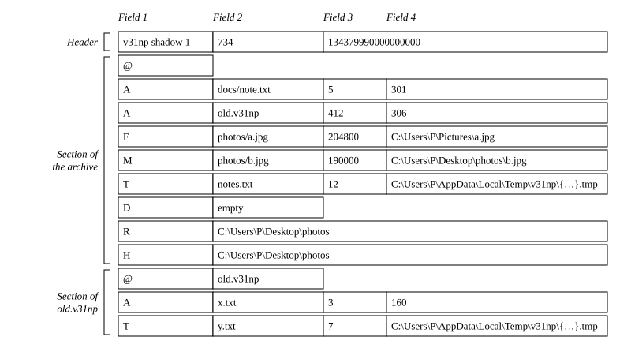

Figure G-5 Layout of a Journal

The time in the header shall be the file time of Windows. A programme on another system shall convert the last-write time of its system to that form, so that a journal written on one system can be checked on another. Each level shall have at most one section. A section shall hold the complete list of entries of its level after all changes, and not a record of operations; a level without a section is as stored. A row before the first section, an unknown kind, a wrong number of fields, a number that is not valid or text that is not valid makes the whole journal unreadable. Table G-6 presents the kinds of rows. Paths in rows shall be absolute paths of the system that wrote the journal, and addresses in rows A shall be offsets within the archive of their level.

<table id="table-g-6">
<caption>Table G-6 Kinds of Rows</caption>
<thead>
<tr><th>Kind</th><th>Fields</th><th>Meaning</th><th>At the repack</th></tr>
</thead>
<tbody>
<tr><td>A</td><td>key, size, address</td><td>Data still in the archive of the level, at the address and of the size given</td><td>Copied from the archive</td></tr>
<tr><td>F</td><td>key, size, path</td><td>A file on the system, linked; the size as it was when linked</td><td>Read as it is at the repack; left out if missing</td></tr>
<tr><td>M</td><td>key, size, path</td><td>As F, but moved in from the system</td><td>As F; the file is deleted after the repack</td></tr>
<tr><td>T</td><td>key, size, path</td><td>A temporary file of the programme, holding content that has no place on the system</td><td>Read; deleted after the repack</td></tr>
<tr><td>D</td><td>key</td><td>An empty folder</td><td>Left out</td></tr>
<tr><td>R</td><td>path</td><td>A folder of the system moved in</td><td>Removed after the repack, with its empty subfolders, if it is empty</td></tr>
<tr><td>H</td><td>path</td><td>An original on the system that the programme hid when it was moved in</td><td>Shown again after the repack if it still exists</td></tr>
</tbody>
</table>

The journal shall be written whole after every change, to a temporary file in the same folder that then replaces it, so that no programme ever reads a journal that is partly written. Temporary files of rows T are kept by the programme in a folder of its choosing. Figure G-6 shows the content to which each row of Figure G-5 refers.

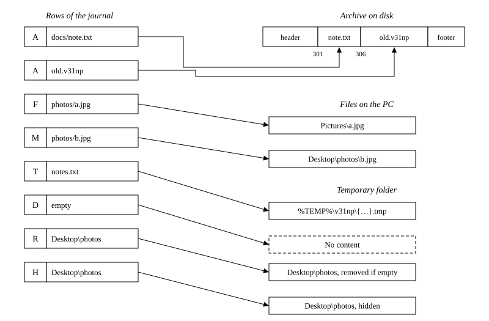

Figure G-6 Rows and Their Content

## ( e ) Changes

Table G-7 presents the rows that each change writes. A change shall not place an item at a key that is already taken; the item shall receive a suffix of Table G-2 or be merged, as set out in § ( G/( ù ) ). Where a row is nonetheless placed at a taken key, as where the copy machinery of the system writes into an archive and so decides (see § ( G/( ù ) )), it shall replace any stored row at that key, every row under it, and any stored row whose key is a folder above it, so that a file can replace a folder of the same name and a folder a file. A row D at or above the key of a new row shall be removed, since the folder is no longer empty.

<table id="table-g-7">
<caption>Table G-7 Changes and the Rows They Write</caption>
<thead>
<tr><th>Change</th><th>Rows</th></tr>
</thead>
<tbody>
<tr><td>Copy from the system</td><td>F for each file; folders are entered recursively, linked folders are not followed</td></tr>
<tr><td>Move from the system</td><td>M for each file, R for each folder moved, and H for each original hidden at the top of the move</td></tr>
<tr><td>Copy within one level</td><td>The rows copied under the new key; M copied as F</td></tr>
<tr><td>Move within one level, rename</td><td>The keys of the rows, and of the sections of nested archives under them, rewritten</td></tr>
<tr><td>Copy or move from another archive or another level</td><td>T for each row A, its data copied to a temporary file; T for each nested archive with a section, built into a temporary file; F for each row F; M for each row M on a move and F on a copy; a new T for each row T; D for each row D. On a move, the rows are then deleted from the source; on a move to another archive, the rows H of the items moved are carried with them</td></tr>
<tr><td>Content from a source without files on the system, such as another virtual folder or a device</td><td>T for each file, D for each folder</td></tr>
<tr><td>Create inside an archive</td><td>T for a file, D for a folder</td></tr>
<tr><td>Delete</td><td>The rows under the key and the sections of nested archives under it removed; D for the folder above, where it is left empty</td></tr>
<tr><td>Pack inside an archive</td><td>T for the new archive; the rows of the selection removed</td></tr>
</tbody>
</table>

A row M that is copied shall become F, so that the original is deleted only once, together with the row that moved it. Deleting the last entry of a folder shall leave the folder as a row D until the repack, as shown in Figure G-7. Renaming or moving a folder shall rewrite the keys of its rows and of the sections of nested archives within it, as shown in Figure G-8.

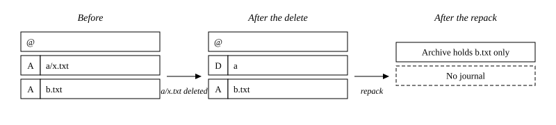

Figure G-7 Deletion of the Last File of a Folder

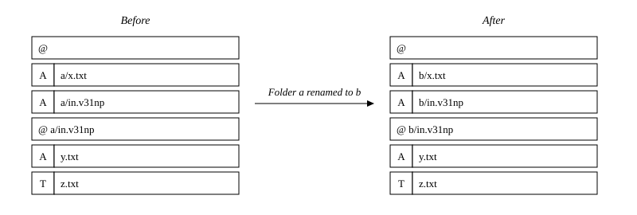

Figure G-8 Renaming of a Folder Holding a Nested Archive

## ( ż ) The Repack

The repack writes the archive with all its pending changes. A programme shall repack an archive after the last of its views of the archive has closed and no view has opened again within a short wait, so that walking between the folders of an archive, which closes one view and opens another, does not cause a repack. Figure G-9 shows views, wait and repack over time. The repack may also be carried out by another programme that leaves the archive earlier; the result is the same, only sooner.

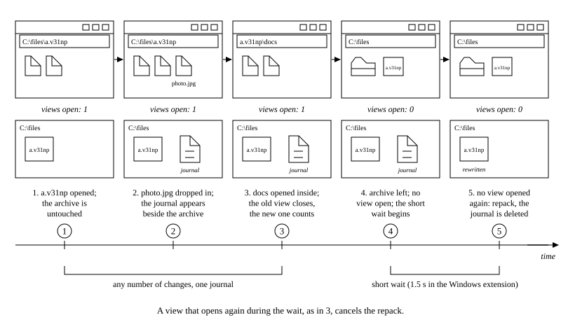

Figure G-9 Views, Wait and Repack

The repack shall run under the lock, as shown in Figure G-10. A stale journal shall be discarded, and a missing or unreadable journal leaves nothing to do. A programme that cannot interpret a path in the journal, such as a path of another system, shall neither repack nor discard the journal, and shall leave it for the system that wrote it; a stale journal shall be discarded nonetheless. Otherwise, the nested archives that have sections shall be built first into temporary files, the innermost first, as shown in Figure G-11, and the archive shall then be written in full beside itself, in the manner of § ( Ù/( b ) ), and shall replace the old file. Linked files shall be read as they are at that moment, so that a changed file is packed changed and a missing file is left out. Rows D shall be left out.

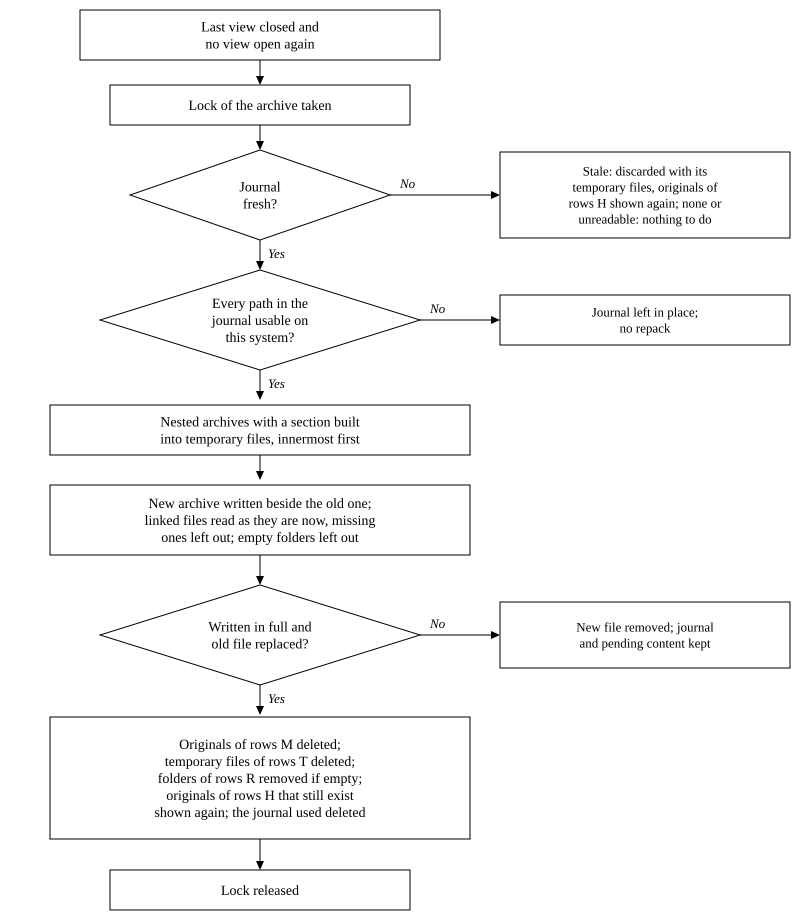

Figure G-10 The Repack

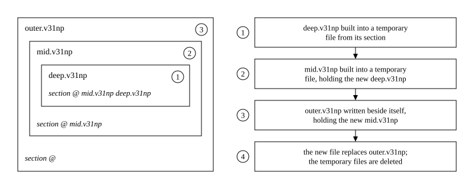

Figure G-11 Order of Writing Nested Archives

Only after the new archive has replaced the old one shall the originals of rows M be deleted, the temporary files of rows T be deleted, the folders of rows R be removed if they are empty, the originals of rows H that still exist be shown again, and the journal that was used be deleted. A journal under the other name (see § ( G/( d ) )) shall be left; it no longer matches the archive, and is found stale and discarded when it is next read. Where writing or replacing fails, the new file shall be removed, and the journal and all pending content shall be kept. Where a programme ends before the repack, the journal shall remain, and the archive shall be repacked when it is next opened and left.

## ( z ) Stale Journals and Concurrency

A journal is valid only for the archive against which it was written. Before using a journal, a programme shall compare the length and the last-write time of the archive with the header of the journal, as shown in Figure G-12. Where they differ, the archive has been changed by another tool since, the addresses of rows A no longer hold, and the journal is stale. A stale journal shall be discarded under the lock, together with those temporary files of its rows T that the programme can reach, and every original of its rows H shall be shown again; the archive on disk shall prevail, and its pending changes are lost. Only the journal that was used shall be discarded; a journal under the other name is left, and is checked in the same manner when it is next read. An unreadable journal shall be ignored, and the next change shall start a new journal from the archive on disk; originals hidden through its rows H remain hidden (see Table G-9).

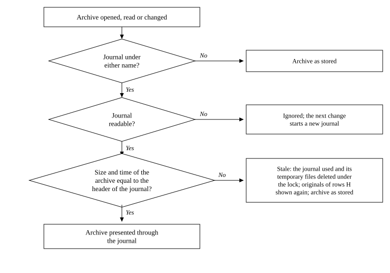

Figure G-12 Check of a Journal

Changes made by several programmes, or by several threads of one, shall be serialised by a lock for each archive that holds across programmes, as shown in Figure G-13. Each change shall read the journal under the lock, so that it builds on the changes made before it. A programme may keep a parsed journal in memory, provided that it detects a newer journal, for example by its length and last-write time.

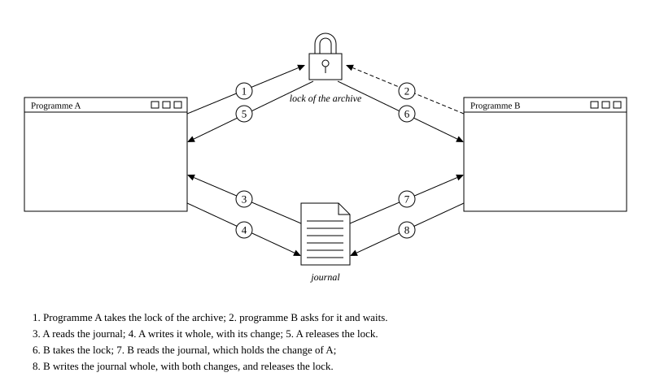

Figure G-13 Two Programmes Changing One Archive

## ( i ) Readers

A programme that reads an archive for which a journal exists shall present the archive with its pending changes. For each level, it shall take the entries from the section of that level where one exists, and from the archive otherwise, as shown in Figure G-14. A nested archive that has a section of its own shall be presented with the length it will have after the repack, computed from the journal, and its content, when it is read as a file, shall first be built into a temporary file.

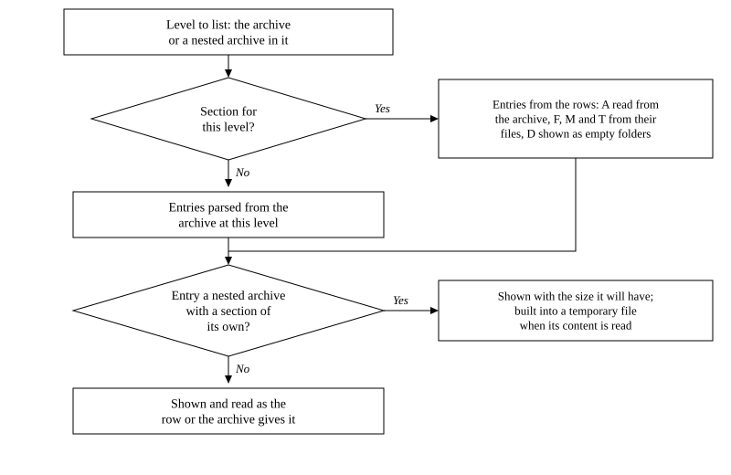

Figure G-14 Listing a Level through the Journal

A programme that can write .v31np files only by writing a whole new archive, and therefore cannot write into the shadow, shall refuse changes while a journal exists, and may read through it.

## ( í ) Edge Cases and Limitations

Table G-8 presents the edge cases of editing and the behaviour required in each. Table G-9 presents the limitations that follow from the design of the shadow; they are accepted.

<table id="table-g-8">
<caption>Table G-8 Edge Cases</caption>
<thead>
<tr><th>Case</th><th>Behaviour</th></tr>
</thead>
<tbody>
<tr><th colspan="2">Names already taken</th></tr>
<tr><td>A file is added under a key that exists</td><td>The incoming file receives a suffix of Table G-2; nothing is replaced</td></tr>
<tr><td>A file is added where a folder of the same name exists, or a folder where a file exists</td><td>The incoming item receives a suffix and keeps all it holds; the existing item is kept</td></tr>
<tr><td>A folder is added where a folder of the same name exists</td><td>Merged; only the clashing files inside receive suffixes</td></tr>
<tr><td>An item is copied into the folder it comes from</td><td>The copy receives a suffix; a folder becomes a new folder with the suffix, holding a full copy</td></tr>
<tr><td>An item is moved onto its own place</td><td>Left as it is</td></tr>
<tr><td>A name is taken at the destination of an extraction</td><td>A file, or a folder landing on a file, receives a suffix; a folder landing on a folder is merged</td></tr>
<tr><td>Files are written by the copy machinery of the system, into or out of an archive</td><td>That machinery decides on names already taken</td></tr>
<tr><td>A folder is moved into itself or into a folder inside it</td><td>Refused</td></tr>
<tr><td>A rename to an empty name, to a name containing /, or to a name used in the folder</td><td>Refused</td></tr>
<tr><td>The name for a packed archive or for baíbíz e alùz is taken</td><td>A suffix of Table G-2</td></tr>
<tr><th colspan="2">Folders</th></tr>
<tr><td>The last entry of a folder is deleted or moved out</td><td>The folder remains, empty, until the repack and then vanishes</td></tr>
<tr><td>A new folder is created and left empty</td><td>Dropped at the repack</td></tr>
<tr><td>A folder moved in from the system still holds files at the repack</td><td>It is kept</td></tr>
<tr><th colspan="2">Linked and moved files</th></tr>
<tr><td>A linked file is changed before the repack</td><td>Packed as it is at the repack</td></tr>
<tr><td>A linked file is missing at the repack</td><td>Its entry is left out</td></tr>
<tr><td>A file moved in is deleted inside the archive before the repack</td><td>It stays on the system and is shown again</td></tr>
<tr><td>An item moved in is moved on to another archive before the repack</td><td>Its row H goes with it; the original stays hidden until that archive is repacked</td></tr>
<tr><td>An original was hidden already when it was moved in</td><td>No row H is written; it is never touched</td></tr>
<tr><td>An item is moved out onto the system</td><td>Removed through the shadow at once, as by a delete; gone from the archive after the repack</td></tr>
<tr><td>An item moved out is skipped, or the move is cancelled</td><td>It stays in the archive</td></tr>
<tr><td>A file moved in is copied inside the archive</td><td>The copy links to it as F; the original is deleted once, at the repack, with the row that moved it</td></tr>
<tr><th colspan="2">The journal</th></tr>
<tr><td>The archive is changed by another tool while a journal exists</td><td>The journal is stale and discarded; the archive on disk prevails</td></tr>
<tr><td>A journal exists under both names and the two are not the same</td><td>The one written most recently among those the programme can read is used</td></tr>
<tr><td>The journal is unreadable</td><td>Ignored; the next change starts a new journal</td></tr>
<tr><td>A journal is deleted at the repack, or discarded, while one exists under the other name</td><td>Only the journal used is deleted; the other no longer matches and is discarded as stale when next read</td></tr>
<tr><td>The journal holds paths the programme cannot interpret</td><td>Neither repacked nor discarded, unless stale</td></tr>
<tr><td>The programme ends before the repack</td><td>The journal remains; the archive is repacked when next opened and left</td></tr>
<tr><td>Changes are made without any view of the archive</td><td>The journal remains until the archive is opened and left</td></tr>
<tr><td>A nested archive with a section is read as a file</td><td>Built first into a temporary file</td></tr>
</tbody>
</table>

<table id="table-g-9">
<caption>Table G-9 Limitations</caption>
<thead>
<tr><th>Limitation</th><th>Consequence</th></tr>
</thead>
<tbody>
<tr><td>A programme repacks when its own last view closes</td><td>Another programme with a view of the archive, such as an Open dialog, may repack before Explorer has left it; the result is correct, only early</td></tr>
<tr><td>A programme that does not follow this division reads the archive as stored</td><td>Until the repack, it does not see the pending changes</td></tr>
<tr><td>A journal may be cached by its length and last-write time</td><td>Two writes of the journal by different programmes within one tick of the file time may hide the second from a programme until the next change</td></tr>
<tr><td>A stale journal is discarded</td><td>Its pending changes are lost; temporary files on another system remain</td></tr>
<tr><td>Temporary content lives outside the archive until the repack</td><td>A cleanup of temporary files before the repack loses it</td></tr>
<tr><td>A journal that cannot be read is ignored</td><td>Originals hidden through its rows H stay hidden on the system</td></tr>
<tr><td>The length of a nested archive with a section is computed from the sizes in the journal</td><td>It may differ from the result once a linked file has changed</td></tr>
</tbody>
</table>

# ( D ) GLOSSARY

<table>
<tbody>
<tr><td>7-Zip plugin</td><td>The programme v31np.dll, which adds .v31np as a format to 7-Zip; see § ( Ú/( b.ii. ) ).</td></tr>
<tr><td>a, b, c</td><td>The fields of T2 that divide a key into its folder, its name and its extension.</td></tr>
<tr><td>Address</td><td>The absolute offset of the first data byte of a file, given in T1.</td></tr>
<tr><td>Archive</td><td>A .v31np file.</td></tr>
<tr><td>ASCII</td><td>American Standard Code for Information Interchange.</td></tr>
<tr><td>Checksum</td><td>The CRC-32 at the end of a file, computed over every byte before it.</td></tr>
<tr><td>CRC-32</td><td>Cyclic redundancy check of 32 bits, with the reflected polynomial EDB88320, an initial value of FFFFFFFF and a final exclusive-or with FFFFFFFF.</td></tr>
<tr><td>Data</td><td>The contents of the files of an archive, stored raw and contiguous after the header.</td></tr>
<tr><td>FAILING</td><td>The medallion of a programme that writes or keeps a file that does not conform to § ( B/( a ) ), or that refuses a file that conforms.</td></tr>
<tr><td>Footer</td><td>The closing π and the checksum; the last 16 bytes of a file.</td></tr>
<tr><td>Header</td><td>The magic, π, T1, π, T2 and π, in that order.</td></tr>
<tr><td>HTTP</td><td>Hypertext Transfer Protocol.</td></tr>
<tr><td>Journal</td><td>The file FUTALUZTU UERSIIA UUTI, followed by the name of an archive, that records the pending changes of the archive; see § ( G/( d ) ).</td></tr>
<tr><td>Key</td><td>The path of a file as UTF-8 text, in which / separates folders.</td></tr>
<tr><td>Level</td><td>An archive or an archive nested in it, named in a journal by the chain of keys that leads to it.</td></tr>
<tr><td>Little-endian</td><td>The byte order in which the least significant byte of a number is stored first.</td></tr>
<tr><td>Magic</td><td>The 15 bytes at the start of a file, the ASCII text V31NSPACKFORMAT.</td></tr>
<tr><td>Mark</td><td>π or φ.</td></tr>
<tr><td>Medallion</td><td>The rating, PASSING or FAILING, by which a programme is rated against the V31NP STANDARD.</td></tr>
<tr><td>Native system</td><td>A service of v31n that reads or writes .v31np files as part of its own operation; see § ( Ú/( a ) ).</td></tr>
<tr><td>Naturalisation</td><td>The derivation, on extraction, of names that are safe for the system written to; see Table Ú-2.</td></tr>
<tr><td>PASSING</td><td>The medallion of a programme of which every .v31np file it writes conforms to § ( B/( a ) ), and which reads every file that conforms.</td></tr>
<tr><td>Repack</td><td>The single rewrite of an archive with all its pending changes, after the user has left it; see § ( G/( ż ) ).</td></tr>
<tr><td>Row</td><td>The description of one file in a table, beginning with 00 φ; in a journal, a line describing one entry of a level, see Table G-6.</td></tr>
<tr><td>Section</td><td>The part of a journal that lists the entries of one level, opened by a line @.</td></tr>
<tr><td>Shadow</td><td>The state of an archive together with its pending changes, held in the journal and the content it refers to; see § ( G/( g ) ).</td></tr>
<tr><td>Size</td><td>The length of the data of a file in bytes, given in T2.</td></tr>
<tr><td>Stale journal</td><td>A journal whose header no longer matches the length and last-write time of its archive.</td></tr>
<tr><td>T1</td><td>The first table of the header, giving the address of each file in data order.</td></tr>
<tr><td>T2</td><td>The second table of the header, giving the size of each file and the division of its key.</td></tr>
<tr><td>UTF-8</td><td>Unicode Transformation Format, 8-bit; the encoding of every key.</td></tr>
<tr><td>V31N order</td><td>The order in which names are sorted, first by the name without its extension and then by the whole name; see § ( G/( b ) ). Syn.: Alphabetical order.</td></tr>
<tr><td>V31NP STANDARD</td><td>The format as defined in § ( B ).</td></tr>
<tr><td>View</td><td>An open presentation of a folder of an archive in a file manager; the repack follows the closing of the last view.</td></tr>
<tr><td>Zip bomb</td><td>An archive of which the extracted size greatly exceeds the stored size.</td></tr>
<tr><td>π</td><td>The mark of 12 bytes taken from the hexadecimal fraction of π, which divides the parts of a file; see Table B-2.</td></tr>
<tr><td>φ</td><td>The mark of 12 bytes taken from the hexadecimal fraction of φ, which divides the rows and fields of a table; see Table B-2.</td></tr>
</tbody>
</table>

# ( E ) REFERENCES

International Organization for Standardization (ISO) (2002) "ISO/IEC 13239: Information technology – Telecommunications and information exchange between systems – High-level data link control (HDLC) procedures", Geneva.

International Telecommunication Union (ITU-T) (2002) "Recommendation V.42: Error-correcting procedures for DCEs using asynchronous-to-synchronous conversion", Geneva.

Internet Engineering Task Force (IETF) (2003) "RFC 3629: UTF-8, a transformation format of ISO 10646".

Internet Engineering Task Force (IETF) (2022) "RFC 9110: HTTP Semantics", section 14, Range Requests.

Microsoft Corporation (n.d.) "Naming Files, Paths, and Namespaces", Win32 documentation.

Pavlov, I. (2026) "7-Zip 26.05".

Unicode Consortium (n.d.) "Unicode Standard Annex #15: Unicode Normalization Forms".
